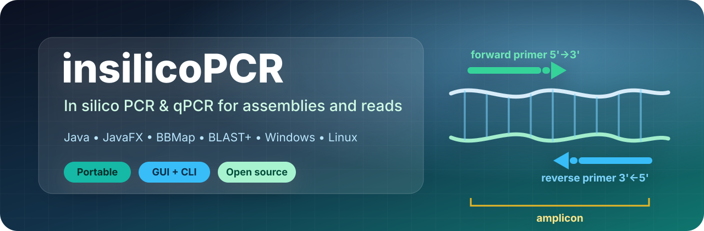
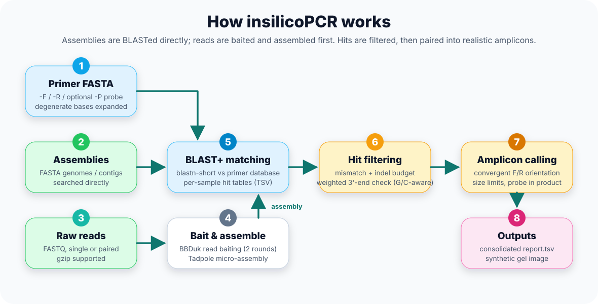
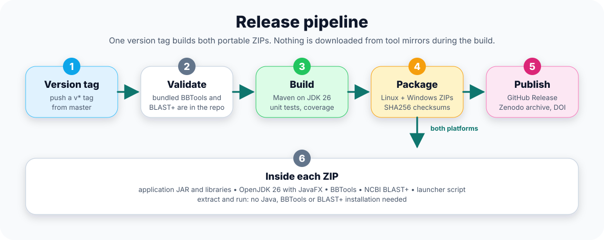

# insilicoPCR

<p align="center">
  
</p>

<p align="center">
  <strong>Portable in silico PCR and qPCR for genome assemblies (FASTA) and sequencing reads (FASTQ)</strong>
</p>

<p align="center">
  <a href="../../actions"></a>
  <a href="https://codecov.io/gh/duceppemo/insilicoPCR"></a>
  <a href="../../releases"></a>
  <a href="https://zenodo.org/badge/latestdoi/828414474"></a>
  <a href="../../wiki"></a>
  
  
  <a href="LICENSE"></a>
</p>

---

## Overview

**insilicoPCR** is a JavaFX desktop and command-line application that tests PCR and qPCR assays *in silico* against **genome assemblies (FASTA)** and **sequencing reads (FASTQ)**, using bundled **BBMap** and **NCBI BLAST+** runtimes. It reports only amplicons that could plausibly form in a real reaction: primer pairs must be convergent on opposite strands, within a configurable product size limit, and free of destabilizing 3'-end mismatches. Typical uses include validating a new assay design against reference genomes, checking **inclusivity** across target strains and **exclusivity** against near-neighbor species, predicting amplicon sizes, and troubleshooting assays that fail on particular isolates.

*Keywords: in silico PCR · virtual PCR · electronic PCR (e-PCR) · qPCR · TaqMan probe · primer specificity · assay validation · inclusivity / exclusivity testing · amplicon prediction · primer mismatch analysis · BLAST · BBMap · molecular diagnostics · food safety · genomics*

<p align="center">
  
</p>

## Features

- Analyze genome assemblies (`.fasta`, `.fa`, `.fna`) and sequencing reads (`.fastq`, `.fq`), single-end or paired-end
- Run standard PCR assays and qPCR/probe assays — mixed in the same primer file if desired, with the probe requirement applied per assay
- Use degenerate primers with IUPAC bases (expanded automatically)
- Realistic amplicon calling:
  - primers must face each other on opposite strands of the same contig
  - product size limits (`--max-length`, default 5000 bp) suppress fragments too long to amplify
  - weighted 3'-end mismatch assessment — mismatches near the primer terminus weigh more, and breaking a G/C pair near the 3' end weighs extra
- Consolidated TSV reports with per-primer mismatch and 3'-end diagnostics
- View results as a synthetic gel image (GUI viewer, or `--gel` PNG export from the CLI)
- Graphical desktop app and CLI in the same portable ZIP (Windows and Linux) with bundled Java, JavaFX, BBMap, and BLAST+

## Quick Start

Download the latest portable ZIP from the [Releases](https://github.com/duceppemo/insilicoPCR/releases) page.

| Operating system | Archive | Launcher |
|---|---|---|
| Linux | `insilicoPCR-<version>-linux-x64.zip` | `run-insilicoPCR.sh` |
| Windows | `insilicoPCR-<version>-windows-x64.zip` | `run-insilicoPCR.bat` |

### Linux GUI

```bash
unzip insilicoPCR-<version>-linux-x64.zip
cd insilicoPCR-linux-x64
chmod +x run-insilicoPCR.sh
./run-insilicoPCR.sh
```

Starting the Linux app from a terminal is recommended because startup messages and errors are shown directly in the console.

### Windows GUI

Extract the ZIP, open the extracted folder, and double-click `run-insilicoPCR.bat`.

The portable launchers configure the bundled Java runtime, JavaFX runtime, BBMap, and BLAST+ automatically — no separate installation required.

## Command-line Usage

```bash
cd insilicoPCR-linux-x64
./runtime/linux/jdk/bin/java -jar insilicoPCR.jar -h
```

Typical CLI run:

```bash
./runtime/linux/jdk/bin/java \
  -jar insilicoPCR.jar \
  -i assemblies_or_reads/ \
  -p primers.fasta \
  -o results/ \
  -t 8 \
  -m 1
```

| Option | Default | Description |
|---|---|---|
| `-i, --input <path>` | required | FASTA/FASTQ file, or directory of them |
| `-o, --output <dir>` | required | Output directory |
| `-p, --primers <file>` | required | Primer FASTA file |
| `-t, --threads <n>` | all cores | Worker threads |
| `-m, --mismatches <n>` | 0 | Allowed mismatches + indels per primer (unaligned 3' bases count too) |
| `--probe-mismatches <n>` | same as `-m` | Allowed mismatches + indels per hydrolysis probe |
| `-e, --evalue <value>` | 1e5 | blastn e-value cutoff; deliberately permissive (see [Amplicon Calling](https://github.com/duceppemo/insilicoPCR/wiki/Amplicon-Calling#blast-e-value)) |
| `-l, --max-length <bp>` | 5000 | Maximum amplicon length; `0` disables the limit |
| `--min-length <bp>` | 0 | Minimum amplicon length |
| `--3p-window <n>` | 5 | Bases at the primer 3' end checked with the weighted penalty |
| `--3p-penalty <score>` | 0 | Maximum tolerated 3'-end penalty (see below) |
| `--5p-truncation <n>` | 5 | Primer bases allowed unaligned at the harmless 5' end |
| `-g, --gel` | off | Also write the synthetic gel image as PNG |
| `--tadpole-k <n>` | 31 | FASTQ mode: Tadpole k-mer length |
| `--tadpole-min-seed <n>` | 2 | FASTQ mode: minimum k-mer count to seed a contig |
| `--tadpole-min-cov <n>` | 1 | FASTQ mode: minimum average contig coverage |
| `--tadpole-min-contig <bp>` | 60 | FASTQ mode: minimum contig length kept |
| `--read-min-fraction <0-1>` | 0.3 | FASTQ mode: share of informative reads that must hold a complete amplicon for a read-level call |

> **FASTQ input:** amplicons are called on a small Tadpole assembly of the baited reads, and on the baited
> reads themselves when the assembly misses a target (rows marked `FASTQ read-level call`). A FASTQ-mode
> negative is still weaker evidence than one from a genome assembly. Assays whose oligos were found in the
> reads but that the assembly missed are listed in `consolidated_report/report_fastq_diagnostics.tsv` and
> summarized in `QAlog.txt`; see
> [Reports](https://github.com/duceppemo/insilicoPCR/wiki/Reports#fastq-mode-and-false-negatives).

See the [Command-line Interface Wiki page](https://github.com/duceppemo/insilicoPCR/wiki/Command-line-Interface) for the full reference.

## How Amplicons Are Called

A forward/reverse hit pair is reported only when **all** of the following hold:

1. Both primers hit the **same contig** on **opposite strands**, facing each other (3' ends pointing inward).
2. The product length is within `--min-length`/`--max-length` (default ≤ 5000 bp). Primer pairs megabases apart no longer produce phantom amplicons.
3. Each primer passes the mismatch budget (`-m`): BLAST mismatches + indels + 3' bases BLAST left unaligned.
4. Each primer passes the **3'-end check**: within the last `--3p-window` bases (default 5), every imperfection is scored and the sum must not exceed `--3p-penalty` (default 0 = perfect 3' end required):

| Imperfection in the 3' window | Penalty |
|---|---|
| Mismatch on the terminal base | 3 |
| Mismatch 1–2 bases from the terminus | 2 |
| Mismatch 3+ bases from the terminus | 1 |
| The broken pair involves a primer G/C within the last 3 bases | +1 |
| Insertion/deletion | +1 |

For example, tolerating a single A/T terminal mismatch requires `-m 1 --3p-penalty 3`; a G/C terminal mismatch requires `--3p-penalty 4`. Hydrolysis probes (`-P`) do not extend, so the 3' rules do not apply to them; a probe hit must simply lie within the amplicon.

## Primer FASTA Format

Primer files must be FASTA files using this assay naming convention:

| Suffix | Meaning |
|---|---|
| `-F` | Forward primer |
| `-R` | Reverse primer |
| `-P` | Probe (qPCR assays) |

```fasta
>targetA-F
ATGCGTACGTTAGCTAGCTA
>targetA-R
TCGATCGATACGCGTACGTA
```

Standard PCR assays and qPCR/probe assays **can be mixed in the same primer FASTA file**: the probe requirement is decided per assay. An assay that defines a `-P` probe is reported only when the probe also hits inside the amplicon; assays without a probe are reported on their primer pair alone (probe columns are left empty on their rows).

Primer files in this convention can also be generated rather than written by hand: [primer-finder](https://github.com/duceppemo/primer-finder) designs selective (q)PCR assays against a group of genomes, writes insilicoPCR-ready primer files, and can run insilicoPCR itself (release 0.8.0 or newer) through its `--insilico-pcr` option.

See the [Primer FASTA Format Wiki page](https://github.com/duceppemo/insilicoPCR/wiki/Primer-FASTA-Format) for detailed examples and limitations.

## Output

The consolidated `report.tsv` contains one row per predicted amplicon:

`Sample, Gene, GenomeLocation, AmpliconSize, Contig, Contig Description, ForwardPrimers, ReversePrimers, ForwardMismatches, ReverseMismatches, Forward3PrimeMismatches, Reverse3PrimeMismatches, Strand` — plus `Probe, ProbeLocation, ProbeSize, ProbeMismatches` when any assay defines a probe (left empty on probe-less rows).

The synthetic gel visualizer displays these results as gel-like bands for quick review of amplicon size patterns across samples. See the [Synthetic Gel Visualizer Wiki page](https://github.com/duceppemo/insilicoPCR/wiki/Synthetic-Gel-Visualizer).

## Documentation

- [insilicoPCR Wiki](https://github.com/duceppemo/insilicoPCR/wiki)
- [Installation](https://github.com/duceppemo/insilicoPCR/wiki/Installation)
- [First Analysis](https://github.com/duceppemo/insilicoPCR/wiki/First-Analysis)
- [Tutorial: Mixed PCR + qPCR with real data](https://github.com/duceppemo/insilicoPCR/wiki/Tutorial-Mixed-PCR-qPCR)
- [Amplicon Calling Rules](https://github.com/duceppemo/insilicoPCR/wiki/Amplicon-Calling)
- [Command-line Interface](https://github.com/duceppemo/insilicoPCR/wiki/Command-line-Interface)
- [Primer FASTA Format](https://github.com/duceppemo/insilicoPCR/wiki/Primer-FASTA-Format)
- [Synthetic Gel Visualizer](https://github.com/duceppemo/insilicoPCR/wiki/Synthetic-Gel-Visualizer)
- [Developer Guide](https://github.com/duceppemo/insilicoPCR/wiki/Developer-Guide)

A source-controlled mirror of the Wiki content is kept under [`docs/wiki/`](docs/wiki/).

## Building From Source

```bash
git clone https://github.com/duceppemo/insilicoPCR.git
cd insilicoPCR
./mvnw test          # unit tests (JUnit 5 + JaCoCo coverage)
./mvnw clean package
java -jar target/insilicoPCR.jar -h
```

Development requires Java 26. End users should normally use the portable releases.

## Architecture and Releases

<p align="center">
  
</p>

Releases are fully automated: pushing a `v*` tag builds the Linux and Windows portable ZIPs and publishes a GitHub Release (archived on Zenodo with a DOI).

<p align="center">
  
</p>

## Citation

If you use insilicoPCR in published work, please cite it via the repository DOI (see the Zenodo badge above, or [`CITATION.cff`](CITATION.cff)):

```bibtex
@software{insilicopcr,
  title  = {insilicoPCR},
  author = {Duceppe, Marc-Olivier},
  url    = {https://github.com/duceppemo/insilicoPCR},
  year   = {2026}
}
```

Please also cite the underlying tools: NCBI BLAST+ and BBMap (BBDuk/Tadpole).

## License

This project is licensed under the MIT License. See [LICENSE](LICENSE) for details.
