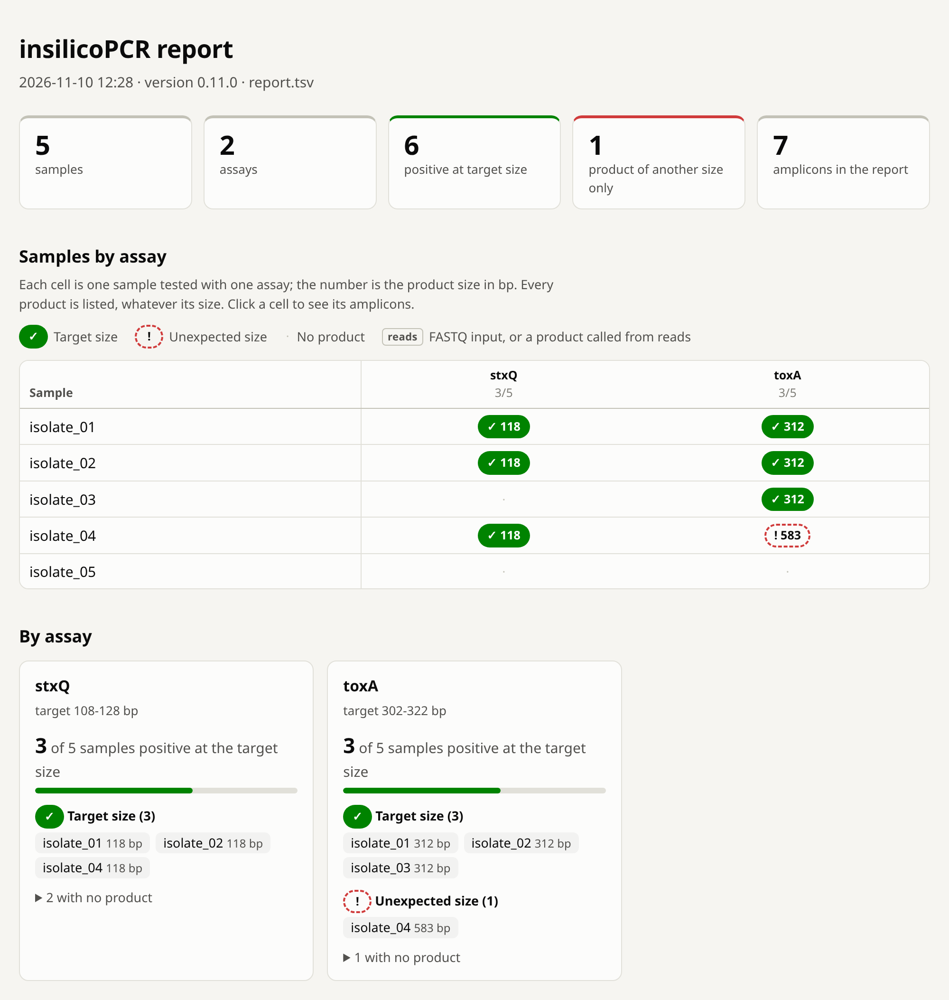
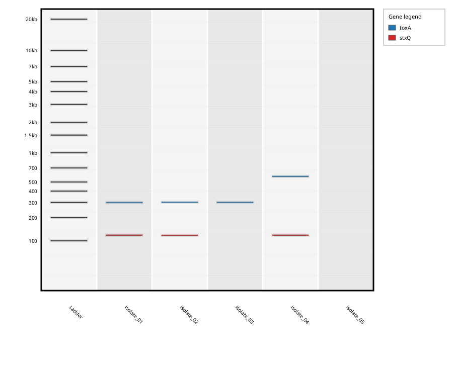
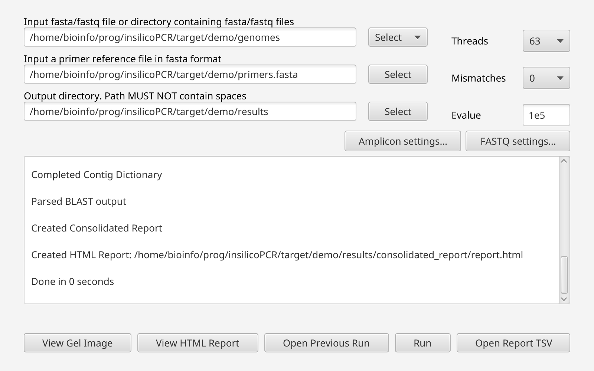

# insilicoPCR

<p align="center">
  
</p>

<p align="center">
  <strong>Portable in silico PCR and qPCR for genome assemblies (FASTA) and sequencing reads (FASTQ)</strong>
</p>

<p align="center">
  <a href="../../actions"></a>
  <a href="https://codecov.io/gh/duceppemo/insilicoPCR"></a>
  <a href="../../releases"></a>
  <a href="https://zenodo.org/badge/latestdoi/828414474"></a>
  <a href="../../wiki"></a>
  
  
  <a href="LICENSE"></a>
</p>

---

## Overview

**insilicoPCR** is a desktop and command-line application that tests PCR and qPCR assays *in silico* against **genome assemblies (FASTA)** and **sequencing reads (FASTQ)**. It reports the amplicons that could form in a real reaction: primer pairs convergent on opposite strands, within a product size limit, and free of destabilizing 3'-end mismatches. Use it to validate an assay design against reference genomes, to check **inclusivity** across target strains and **exclusivity** against near neighbours, to predict amplicon sizes, and to find out why an assay fails on particular isolates.

*Keywords: in silico PCR · virtual PCR · electronic PCR (e-PCR) · qPCR · TaqMan probe · primer specificity · assay validation · inclusivity / exclusivity testing · amplicon prediction · primer mismatch analysis · BLAST · BBMap · molecular diagnostics · food safety · genomics*

<p align="center">
  
</p>

## Features

- **Assemblies and reads.** FASTA genomes are searched directly; FASTQ reads (single or paired, gzipped or not) are baited and micro-assembled first, and a product the mini-assembly misses is called from the reads themselves, even one longer than a read.
- **PCR and qPCR in one primer file.** An assay with a probe is reported only when the probe sits inside the amplicon. Degenerate (IUPAC) primers are expanded automatically.
- **Realistic amplicon calling.** Primers must face each other on one contig, within a size limit, with a weighted 3'-end mismatch check that knows a terminal G/C mismatch is worse than an A/T one.
- **Every product is reported, whatever its size**, as a real PCR would amplify it. Declare the size an assay is designed to give and each product is labelled `target`, `other` or `unexpected`.
- **Reports you can read.** A self-contained HTML report, a TSV table with per-primer mismatch details, and a synthetic gel.
- **Nothing to install.** One portable ZIP for Windows or Linux holds the desktop app, the command line, Java, BBTools and BLAST+.
- **Works with [primer-finder](https://github.com/duceppemo/primer-finder)**, which designs selective (q)PCR assays and writes primer files in this format.

### Which samples are positive?

The HTML report answers it at a glance: one row per sample, one column per assay, the product size in each cell.

<p align="center">
  
</p>

Here both assays declare their product size. Green cells are products of that size; `isolate_04` gives the `toxA` product at 583 bp, which is reported and marked as an unexpected size instead of being counted as positive.

### The same results as a gel

<p align="center">
  
</p>

### Desktop app or command line

<p align="center">
  
</p>

## Quick Start

**1. Download** the portable ZIP for your system from the [Releases](https://github.com/duceppemo/insilicoPCR/releases) page and extract it. Nothing else needs to be installed.

**2. Write a primer file.** It is a FASTA file in which each ID ends in `-F` (forward), `-R` (reverse) or `-P` (probe, qPCR assays only); the text before the suffix names the assay. `size=` is optional and declares the expected product size:

```fasta
>toxA-F size=312
ATGCGTACGTTAGCTAGCTA
>toxA-R
TCGATCGATACGCGTACGTA
```

**3. Run it.** Start the desktop app with `./run-insilicoPCR.sh` on Linux, or by double-clicking `run-insilicoPCR.bat` on Windows. Choose the input (a FASTA/FASTQ file or a folder of them), the primer file and an output folder, then click **Run**.

Or use the command line, from the extracted folder:

```bash
./runtime/linux/jdk/bin/java -jar insilicoPCR.jar -i genomes/ -p primers.fasta -o results/
```

**4. Read the results.** Open `results/consolidated_report/report.html` in a web browser (in the desktop app: **View HTML Report**). The same results are in `report.tsv`, one row per amplicon.

Next steps: the [tutorial](https://github.com/duceppemo/insilicoPCR/wiki/Tutorial-Mixed-PCR-qPCR) runs two assays on public *Listeria* genomes and reads, and the [command-line reference](https://github.com/duceppemo/insilicoPCR/wiki/Command-line-Interface) lists every option.

## Documentation

Everything else is in the [Wiki](https://github.com/duceppemo/insilicoPCR/wiki):

| To do this | Read |
|---|---|
| Install and run a first analysis | [Installation](https://github.com/duceppemo/insilicoPCR/wiki/Installation) · [First Analysis](https://github.com/duceppemo/insilicoPCR/wiki/First-Analysis) · [Tutorial](https://github.com/duceppemo/insilicoPCR/wiki/Tutorial-Mixed-PCR-qPCR) |
| Use the desktop app or the command line | [GUI Overview](https://github.com/duceppemo/insilicoPCR/wiki/GUI-Overview) · [Command-line Interface](https://github.com/duceppemo/insilicoPCR/wiki/Command-line-Interface) (all options) |
| Write primer files | [Primer FASTA Format](https://github.com/duceppemo/insilicoPCR/wiki/Primer-FASTA-Format) · [Standard PCR vs qPCR](https://github.com/duceppemo/insilicoPCR/wiki/Standard-PCR-vs-qPCR) |
| Understand a call | [Amplicon Calling](https://github.com/duceppemo/insilicoPCR/wiki/Amplicon-Calling) · [Reports](https://github.com/duceppemo/insilicoPCR/wiki/Reports) · [Synthetic Gel Visualizer](https://github.com/duceppemo/insilicoPCR/wiki/Synthetic-Gel-Visualizer) |
| Fix a problem | [Troubleshooting](https://github.com/duceppemo/insilicoPCR/wiki/Troubleshooting) · [FAQ](https://github.com/duceppemo/insilicoPCR/wiki/FAQ) |
| Build or contribute | [Developer Guide](https://github.com/duceppemo/insilicoPCR/wiki/Developer-Guide) · [Build System](https://github.com/duceppemo/insilicoPCR/wiki/Build-System) · [Architecture](https://github.com/duceppemo/insilicoPCR/wiki/Architecture) · [Release Pipeline](https://github.com/duceppemo/insilicoPCR/wiki/Release-Pipeline) |

The Wiki pages are kept in this repository under [`docs/wiki/`](docs/wiki/).

## Citation

If you use insilicoPCR in published work, please cite it via the repository DOI (see the Zenodo badge above, or [`CITATION.cff`](CITATION.cff)):

```bibtex
@software{insilicopcr,
  title  = {insilicoPCR},
  author = {Duceppe, Marc-Olivier},
  url    = {https://github.com/duceppemo/insilicoPCR},
  year   = {2026}
}
```

Please also cite the underlying tools: NCBI BLAST+ and BBMap (BBDuk/Tadpole).

## License

This project is licensed under the MIT License. See [LICENSE](LICENSE) for details.
