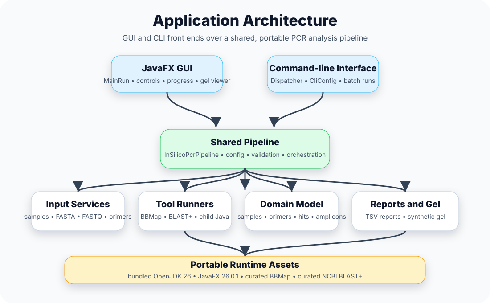

# Architecture

insilicoPCR uses a shared pipeline behind both the graphical interface and command-line interface.



One dispatcher starts the desktop GUI when it is given no arguments and the command line otherwise. Both run the same pipeline stages, which call the bundled external tools (BBTools and BLAST+), pass the BLAST hits to the shared analysis core, and write the reports from the amplicons it calls. Everything runs from the portable runtime shipped in the release ZIP.

## Entry points

| Area | Entry point |
|---|---|
| Dispatcher | `ca.canada.inspection.dispatchpcr.Dispatcher` |
| GUI | `ca.canada.inspection.insilicopcr.MainRun` |
| CLI | `ca.canada.inspection.commandpcr.CommandMain` |
| Pipeline | `ca.canada.inspection.pipeline.InSilicoPcrPipeline` |
| Analysis core | `ca.canada.inspection.pcr` |

The dispatcher starts the GUI when no command-line arguments are provided. When CLI arguments are present, it runs the command-line pipeline.

## Shared analysis core (`ca.canada.inspection.pcr`)

Both the GUI pipeline (`PcrPipelineTask`) and the CLI pipeline (`InSilicoPcrPipeline`) delegate the scientific decisions to one shared, JavaFX-free package, so the two interfaces cannot drift apart:

| Class | Responsibility |
|---|---|
| `AmpliconOptions` | Immutable knobs: mismatch budget, 3' window/penalty, 5' truncation allowance, product size limits |
| `BlastHitParser` | Parses BLAST TSV lines and applies the hit acceptance rules (mismatch budget, 3'-end coverage, weighted 3' penalty; probes exempt from 3' rules; trimmed probe ends and primer 3' ends compared with the template by `TrimmedEnds`, the template read alongside the report by `QueryTemplates`) |
| `BlastReports` | Walks per-sample BLAST reports and attaches accepted hits to samples |
| `AmpliconCaller` | Pairs forward/reverse hits: same contig, opposite strands, convergent orientation, size limits |
| `TrimmedEnds` | Compares the oligo bases BLAST trimmed off the ends of an alignment with the template: probe ends and primer 3' ends count only where they do not pair |
| `QueryTemplates` | Reads the contig or read a hit lies on from the FASTA that was searched, one query at a time and at one byte per base (`PackedBases`), for `TrimmedEnds` |
| `ConsolidatedReport` | Writes the consolidated TSV (standard and qPCR modes); also exposes its rows for read-level calling |
| `ReadLevelCaller` | FASTQ mode: calls amplicons on baited reads treated as tiny contigs, one call per product size, with the support rules (≥ 2 fragments, `--read-min-fraction` of the informative ones: reads carrying a primer at the product's locus) |
| `ReadExtensionCaller` | FASTQ mode: for assays in no contig and in no read, picks the primer-carrying reads to extend and finds products on the extended reads (at least 2 reads seeded from each primer), reported when `PairSupport` confirms them |
| `PairSupport` | FASTQ mode: checks a product found on extended reads against the sample's read pairs (every window inside enough fragments; no repeat longer than the window), so that a wrong turn through a repeat is not reported |
| `FastqDiagnostics` | FASTQ mode: explains assays the mini-assembly did not report though their oligos are in the reads |
| `ExpectedSizes` | Product sizes declared in primer FASTA headers (`size=`, `other=`); labels report rows `target` / `other` / `unexpected` and never filters |
| `HtmlReport` | Writes the self-contained HTML report from the consolidated TSV: sample-by-assay grid, per-assay summary, amplicon table |

Three classes outside this package are shared by both pipelines as well:

| Class | Responsibility |
|---|---|
| `util.InputCheck` | Finds the samples of the input and checks every file before the run; a sample with a faulty file is left out and reported, the others are run |
| `util.FastqCheck` | Reads a FASTQ file to its end and names the first fault (empty, gzip damaged or cut short, file ending inside a read, malformed read) |
| `pipeline.RunFailure` | Tells a failure the user can act on (reported as `Error:` and `Cause:` lines) from one that points at the program (reported with its stack trace) |

`BlastResult` (in `insilicopcr`) carries full alignment context (strand, subject coordinates, aligned sequences) and computes the 3'-end mismatch counts and weighted penalties. The rules themselves are documented on the [Amplicon Calling](Amplicon-Calling) page, and covered by unit tests under `src/test/java`.

## High-level layers

```text
GUI / CLI
   ↓
Dispatcher
   ↓
Shared pipeline
   ↓
Input services, primer service, FASTQ processing, BLAST database building
   ↓
BBMap / BLAST+ runners
   ↓
Parsers and domain model
   ↓
Reports and synthetic gel visualization
```

## Design goals

- Keep GUI and CLI behavior consistent.
- Keep runtime discovery centralized.
- Keep external tool execution isolated from UI code.
- Keep reports and synthetic gel visualization based on structured pipeline output.
- Preserve portable release behavior across Windows and Linux.
