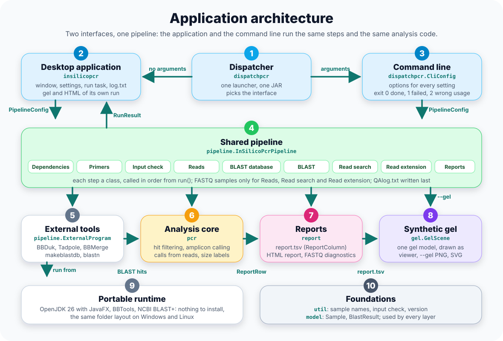

# Architecture

insilicoPCR uses a shared pipeline behind both the graphical interface and command-line interface.



One dispatcher starts the desktop GUI when it is given no arguments and the command line otherwise. Both run the same pipeline stages, which call the bundled external tools (BBTools and BLAST+), pass the BLAST hits to the shared analysis core, and write the reports from the amplicons it calls. Everything runs from the portable runtime shipped in the release ZIP.

## Entry points

| Area | Entry point |
|---|---|
| Dispatcher | `ca.canada.inspection.dispatchpcr.Dispatcher` |
| GUI | `ca.canada.inspection.insilicopcr.MainRun` |
| CLI | `ca.canada.inspection.dispatchpcr.CliConfig` (options to a `PipelineConfig`) |
| Pipeline | `ca.canada.inspection.pipeline.InSilicoPcrPipeline` |
| Analysis core | `ca.canada.inspection.pcr` |

The dispatcher starts the GUI when no command-line arguments are provided. When CLI arguments are present, `CliConfig` reads them into a `PipelineConfig`, and the dispatcher runs the pipeline with it (exit code 0 done, 1 failed, 2 wrong command line). The defaults of a run and the checks of its settings are in one place, `PipelineConfig.builder` (with `AmpliconOptions.builder` for the amplicon rules), which the command line, the application and the tests all start from; the command line sets only the options it is given, and its help reads the defaults from the same constants. `RunSettings` describes a run's settings once, each with its command-line option, for the run's log, `QAlog.txt` and the HTML report's **Run details** (a `report.RunDetails`).

## Packages

Each package depends only on those below it in this table, so there are no cycles:

| Package | Holds | Uses |
|---|---|---|
| `dispatchpcr` | The entry point and the command-line options | everything below |
| `insilicopcr` (and `insilicopcr.ui`) | The application window and its dialogs | `pipeline`, `gel`, `report`, `pcr`, `util` |
| `pipeline` | The run: its steps, the external programs, the runtime layout (`AppPaths`); no JavaFX (`PackageRulesTest`) | `gel`, `report`, `pcr`, `model`, `util` |
| `gel` | The synthetic gel: its geometry, the viewers, the image files | `report` (to read `report.tsv`), `pcr` |
| `report` | The files a run writes and reads back: `report.tsv` (its columns in `ReportColumn`, written by `ConsolidatedReport`, read by `ReportTsv`), the HTML report, the FASTQ diagnostics | `pcr`, `model`, `util` |
| `pcr` | The analysis core: primer IDs, hit filtering, amplicon calling, read-level calls; no report file | `model`, `util` |
| `util` | Input checks, sequence file helpers, the version (`Version`, filled in from `pom.xml` at build time) | `model` |
| `model` | `Sample` and `BlastResult` | nothing |

The GUI runs the same pipeline: `insilicopcr.PcrPipelineTask` runs `InSilicoPcrPipeline` on a background thread and gives it a `RunMonitor` that sends messages, program output and progress to the window; cancelling the task (the window closing) kills the external programs, and the task appends what the run showed to `log.txt` however it ends. The command line gives it `RunMonitor.CONSOLE`. A finished run returns a `RunResult` (its report, HTML report and samples), which the window's buttons use; `QAlog.txt` names the same report and samples, which `PreviousRun` reads back to reopen the run. Every external program (BLAST+, BBTools) is started by one class, `pipeline.ExternalProgram`.

## Pipeline stages (`ca.canada.inspection.pipeline`)

`InSilicoPcrPipeline.run` goes through the steps of `RunMonitor.Step` in order, reporting each one to the monitor. Every step is called from there, so the method reads as the run; each step is a class with a static entry point:

| Step | Classes | What happens |
|---|---|---|
| Dependencies | `RuntimeDependencies` | Find the bundled tools |
| Primers | `PrimerService` | Read the primer FASTA (every assay needs `-F` and `-R`), expand degenerate bases, write `primer_tmp.fasta`; first, so that a mistake there is found before the input is read |
| Input check | `util.InputCheck` | Find the samples and check their files |
| Reads | `FastqProcessor`, `BbtoolsCommands`, `ChildJavaMemory` | FASTQ samples: two rounds of BBDuk baiting, Tadpole mini-assembly, BBMerge of baited pairs. Each BBTools command runs in the folder of the file it writes and names its files relative to it (`BbtoolsCommands.Command`): BBTools reads a comma in a file argument as a list of files |
| BLAST database, BLAST | `BlastDatabaseBuilder`, `BlastRunner`, `ContigService`, `pcr.BlastReports` | `makeblastdb` on the primers; `blastn` of every sample, one thread each, several samples at a time; the accepted hits attached to their samples |
| Read search, read extension | `ReadLevelStage`, `ReadExtensionStage` | FASTQ samples: amplicons called on the baited reads; reads extended for products longer than a read |
| Reports | `ReportGenerator`, `FastqDiagnosticsStage`, `QaLogWriter` | Writes `report.tsv`, the FASTQ diagnostics, the HTML report, the `--gel` image and, last, `QAlog.txt`; returns the `RunResult`; runs no program |

The output folder's layout is written in two places only: `PipelineDirectories` (the output, `detailed_report` and `consolidated_report` folders, the primer database) and `SampleFiles`, the files of one sample in `detailed_report/<sample>/`, every one named after the sample, not its input file (its BLAST report `<sample>.tsv`, the baited reads, the mini-assembly, the read search and extension files). The steps that write a file and those that read it both ask `SampleFiles` for it.

Samples are processed several at a time by `ParallelStageRunner`, on daemon threads, which stops starting new samples once one has failed, or once the run is cancelled. For the BBTools steps, `ChildJavaMemory.share` splits the threads and the memory between the samples running at once: half of insilicoPCR's heap in all, at least 4 GB and at most 64 GB per program. A BBTools program that runs out of memory stops in one of two ways: with exit code 3, from `-XX:+ExitOnOutOfMemoryError`, when the Java runtime runs out of heap; or with exit code 1 after printing `This program ran out of memory.`, when one of its k-mer tables, sized from the heap, is full (Tadpole on a large sample, with heap to spare). `ExternalProgram` reads the programs' error output, passing it on, to recognise that line (`ProgramFailedException.saidOutOfMemory`). `FastqProcessor` sets such a sample aside and, after the others, runs it again alone with everything, from the step that ran out. The user-facing behaviour is on [Threads and memory in FASTQ mode](Command-line-Interface#threads-and-memory-in-fastq-mode).

## Shared analysis core (`ca.canada.inspection.pcr`)

The pipeline delegates the scientific decisions to one JavaFX-free package:

| Class | Responsibility |
|---|---|
| `PrimerId` | The primer naming rule (`<assay>-F`, `-R`, `-P`): reads an ID into its assay and role, and groups a run's primers by assay |
| `PrimerPanel` | The primers of a run, read once by `PrimerService`: each oligo's sequence (degenerate ones expanded), the assays they form, which have a probe, and the product sizes the file declares; passed to every step that needs the primers |
| `AmpliconOptions` | Immutable knobs: mismatch budget, 3' window/penalty, 5' truncation allowance, product size limits |
| `BlastField` | The columns of the BLAST TSV, in order: the `-outfmt` blastn is given, the header and the parser's fields |
| `BlastHits` | The one reader of a BLAST TSV into a sample (contigs, baited reads, extended reads), with the warning for trimmed hits whose sequence is missing from the searched file |
| `BlastHitParser` | Parses one BLAST TSV line and applies the hit acceptance rules (mismatch budget, 3'-end coverage, weighted 3' penalty; probes exempt from 3' rules; trimmed probe ends and primer 3' ends compared with the template by `TrimmedEnds`, the template read alongside the report by `QueryTemplates`) |
| `BlastReports` | Reads the BLAST report of each of the run's samples (where the pipeline says it is) and attaches their accepted hits |
| `AmpliconCaller` | Pairs forward/reverse hits: same contig, opposite strands, convergent orientation, size limits |
| `TrimmedEnds` | Compares the oligo bases BLAST trimmed off the ends of an alignment with the template: probe ends and primer 3' ends count only where they do not pair |
| `QueryTemplates` | Reads the contig or read a hit lies on from the FASTA that was searched, one query at a time and at one byte per base (`PackedBases`), for `TrimmedEnds` |
| `Products` | Finds the products of a sample as `ReportRow`s: its hits paired into amplicons, an assay with a probe only where its probe binds within; the same rules for contigs, reads and extended reads |
| `ReportRow` | One product as the report lists it (amplicon, primers, mismatches, probe); passed between the steps of a run, and turned into TSV columns only when the report is written |
| `ReadLevelCaller` | FASTQ mode: calls amplicons on baited reads treated as tiny contigs, one call per product size, with the support rules (≥ 2 fragments, `--read-min-fraction` of the informative ones: reads carrying a primer at the product's locus) |
| `ReadExtensionCaller` | FASTQ mode: for assays in no contig and in no read, picks the primer-carrying reads to extend and finds products on the extended reads (at least 2 reads seeded from each primer), reported when `PairSupport` confirms them |
| `PairSupport` | FASTQ mode: checks a product found on extended reads against the sample's read pairs (every window inside enough fragments; no repeat longer than the window), so that a wrong turn through a repeat is not reported |
| `FastqDiagnostics` | FASTQ mode: explains assays the mini-assembly did not report though their oligos are in the reads. Its statuses say which are called from reads and which withheld (`Status.isCalled`, `isWithheld`). Its `SPLIT_ACROSS_CONTIGS` means the primers hit the mini-assembly's contigs but never the same one, with each hit's distance to its contig end (measured as by `SplitAcrossContigs`); unlike the assemblies' "primers at contig ends", it does not require them to point off the ends |
| `ExpectedSizes` | Product sizes declared in primer FASTA headers (`size=`, `other=`); labels report rows `target` / `other` / `unexpected` and never filters |
| `AssayVerdict` | What a sample shows for an assay (target size, other product, seen in too few reads, primers at contig ends, ...), with why; also which kinds count as positive, how they group (positive, other size, withheld, negative) and which product sizes decide each. The HTML report draws it and counts by these, with no rule of its own |
| `SplitAcrossContigs` | Assemblies: assays without a product whose primers point off the ends of two contigs (or both ends of one), with the smallest product joining them would give |

The files are written and read by `ca.canada.inspection.report`:

| Class | Responsibility |
|---|---|
| `ConsolidatedReport` | Writes `report.tsv` (standard and qPCR modes) from `Products` and the rows called from reads |
| `ReportTsv` | Reads a `report.tsv` back into `ReportRow`s, by column name, for the gel and a past run opened in the application (refusing a file that is not a report) |
| `HtmlReport` | Writes the self-contained HTML report from the run's `ReportRow`s (the verdict of each sample and assay from `pcr.AssayVerdict`): sample-by-assay grid, per-assay summary, amplicon table; its style and script are the resources `report.css` and `report.js` |
| `FastqDiagnosticsReport` | Writes `report_fastq_diagnostics.tsv` from the `FastqDiagnostics` findings |

Three classes outside these packages take part in every run as well:

| Class | Responsibility |
|---|---|
| `util.InputCheck` | Finds the samples of the input and checks every file before the run; a sample with a faulty file is left out and reported, the others are run |
| `util.FastqCheck` | Reads a FASTQ file to its end and names the first fault (empty, gzip damaged or cut short, file ending inside a read, malformed read) |
| `pipeline.RunFailure` | Tells a failure the user can act on (reported as `Error:` and `Cause:` lines) from one that points at the program (reported with its stack trace) |

## Synthetic gel (`ca.canada.inspection.gel`)

The gel viewer (`InteractiveGelViewer`, one gel of up to 100 samples at a time, with a page bar for larger runs) and the `--gel` image (`GelImageWriter`, in `gel` with the rest of the JavaFX drawing) share plain classes that need no window and have unit tests:

| Class | Responsibility |
|---|---|
| `GelScale` | The gel's log scale (base pairs to position), the ladder, and the small per-band variations |
| `GelLayout` | Geometry of a gel picture: where the gel sits, lane width, picture size, the baseline of the slanted lane labels |
| `LaneBand` | One band of a sample lane: the amplicons it stands for, where it sits, how strong it looks |
| `BandPaint` | Colours of the gel and of the bands |
| `GelText` | Text about the amplicons of a band: tooltips, details, selection and search |
| `GelPages` | Splitting the lanes of a large run into pages of samples |
| `GelScene` | What a gel picture is made of (gel, lanes, ladder, bands, labels), whatever draws it |
| `GelNodes` | A `GelScene` as JavaFX nodes, for the viewer |
| `GelSvg` | A `GelScene` as an SVG document |
| `GelImages` | PNG and PDF files of the gel, their default names, snapshots of the viewer |
| `SyntheticGelImage` | The `--gel` PNG: a `GelScene` drawn on a canvas, without a window |

`BlastResult` (in `model`) carries full alignment context (strand, subject coordinates, aligned sequences) and computes the 3'-end mismatch counts and weighted penalties. The rules themselves are documented on the [Amplicon Calling](Amplicon-Calling) page, and covered by unit tests under `src/test/java`. `EndToEndTest` runs whole runs on the five-isolate example with the BLAST+ and BBTools of the checkout.

## High-level layers

```text
Dispatcher
   ↓
GUI (PcrPipelineTask + window RunMonitor)  /  CLI (RunMonitor.CONSOLE)
   ↓
Shared pipeline (InSilicoPcrPipeline)
   ↓
Primers, input check, FASTQ processing, BLAST database, BLAST, read search and extension
   ↓
External programs: BBTools, BLAST+ (ExternalProgram, ParallelStageRunner)
   ↓
Analysis core (pcr): hit filtering, amplicon calling, read-level calls
   ↓
Reports (report) and synthetic gel (gel)
```

## Design goals

- Keep GUI and CLI behavior consistent.
- Keep runtime discovery centralized.
- Keep external tool execution isolated from UI code.
- Keep reports and synthetic gel visualization based on structured pipeline output.
- Preserve portable release behavior across Windows and Linux.
