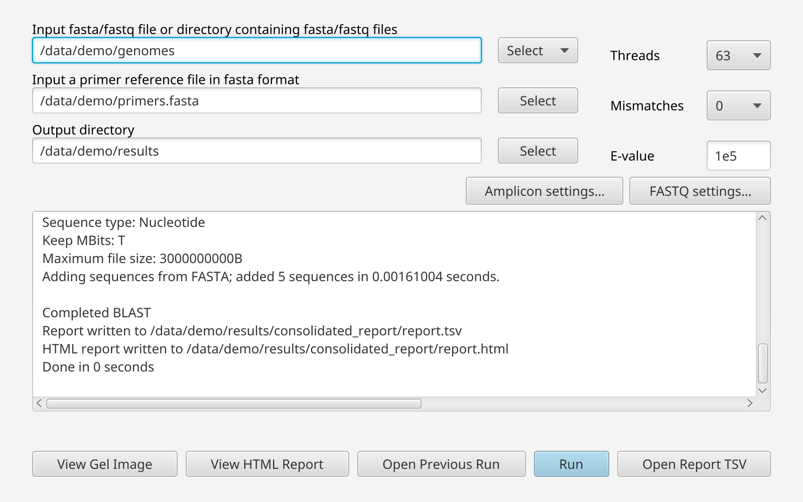
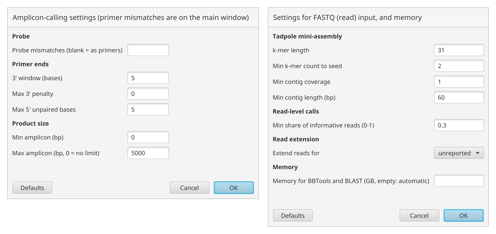

# GUI Overview

The graphical interface is intended for interactive analysis and result review.

The window of version 0.15.2 after a run on a folder of five FASTA files (since 2.0, **Anneal (°C)** takes the place of **Mismatches**): the three path fields with their **Select** buttons, the run parameters on the right, the two settings buttons, the log, and the action buttons along the bottom.

## Main workflow

The GUI lets users select:

- input FASTA/FASTQ file or directory (**Select ▾** → **File…** or **Folder…**, or drag it onto the field; files and folders are told apart automatically; a field takes one file or folder, so dropping both files of a read pair is refused: drop their folder)
- primer FASTA file
- output directory
- number of worker threads (one fewer than the computer's processors at most, so the window stays responsive; the command line's `-t` default is all of them)
- the annealing temperature, **Anneal (°C)** (default 60; `--anneal-temp`): a primer or probe site is accepted when its Tm on the template reaches it less the Tm margin (since 2.0, in place of the allowed mismatches)
- BLAST e-value

Paths can also be typed or pasted into the input, primer and output fields: a leading `~` is your home folder, and a relative path is made absolute.

Two buttons above the log open the remaining settings. Each dialog has **Defaults**, checks values on **OK**, and a ` *` on the button means a value differs from the default; hover the button for a summary.

| Dialog | Settings | Command-line equivalents |
|---|---|---|
| **Amplicon settings…** | Tm margin (°C); the reaction the Tm assumes: Na+ / K+ (mM), Mg2+ (mM), dNTP (mM), each oligo (nM); 3' window, max 3' penalty; min and max amplicon length. Since 2.0: probe mismatches and max 5' unpaired bases are gone | `--tm-margin`, `--na`, `--mg`, `--dntp`, `--oligo-conc`, `--3p-window`, `--3p-penalty`, `--min-length`, `--max-length` |
| **FASTQ settings…** | Tadpole k-mer length, min k-mer count to seed, min contig coverage, min contig length; min share of informative reads for read-level calls; which assays reads are extended for, to find products longer than a read (unreported, target or off); the memory for BBTools and BLAST (empty: automatic; it sizes the BLAST searches of assemblies too) | `--tadpole-k`, `--tadpole-min-seed`, `--tadpole-min-cov`, `--tadpole-min-contig`, `--read-min-fraction`, `--read-extension`, `--memory` (`--bbtools-memory` before 1.0) |

The dialogs as in 1.x; since 2.0 **Amplicon settings…** holds the fields listed above.

See [Amplicon Calling](Amplicon-Calling) and [FASTQ mode and false negatives](Reports#fastq-mode-and-false-negatives) for what they do.

After the inputs are selected, click **Run** to start the analysis. The run first checks every input file (since 0.13.0): a sample with an empty, damaged or malformed file is left out with a `Warning:` line in the log and the other samples are run; see [Input check](Running-Analyses#input-check). While a run goes on, **Run** reads **Stop**: it asks for confirmation, then stops the run and the programs it runs, and the window stays open (since 0.15.3; before, only closing the window stopped a run). The run writes no report; what the window showed of it is added to `log.txt` with `Run cancelled`. The button reads **Stopping…** until the run has ended, then **Run** again, so two runs of the window never write to one output folder at once.

## Progress and logs

The application displays progress and log output during the run, including the output of the external tools (BBDuk, Tadpole, BBMerge, BLAST).

The application runs the same pipeline as the command line (since 0.14.0), so FASTQ samples are baited and assembled several at a time, sharing the threads and memory; the log says how (`BBTools: 2 samples at a time, each with 4 threads and -Xmx4g`). The BBTools programs' memory is worked out from the computer; **FASTQ settings…**, **Memory for BBTools and BLAST** sets it instead (on a computer shared with others, say); see [Threads and memory in FASTQ mode](Command-line-Interface#threads-and-memory-in-fastq-mode).

On Linux, starting the launcher from a terminal is recommended because startup messages and errors are also visible in the console.

Every run that finishes writes its log, as on the command line: `QAlog.txt` with `report.tsv`, `QAlog(1).txt` with `report(1).tsv`, and so on; it names the report the run wrote and the samples it analysed. At the end of every run, finished, failed or stopped, what the window showed of it is added to `log.txt` in its output folder (before 0.15.1, `log.txt` was written for the last run only, when the window closed), under a line giving the run's date and time and its input, primer file and output folder (since 0.15.3: the runs of a folder followed one another in it, without them). Closing the window during a run stops it and the external tools it runs; the run still adds to `log.txt` (`Run cancelled`) and leaves the logs of the finished runs in the folder. A run refused because another run holds the folder writes nothing in it, not even `log.txt` (before 0.15.4 its lines went into the other run's).

## Post-run actions

| Button | What it does |
|---|---|
| **View Gel Image** | Shows the synthetic gel of the last run of this window, whatever the output field holds by then: the report that run wrote, with a lane for every sample it analysed, with or without a band, in black at first (**Color** offers the gene colours `--gel` draws, or the size check) (before 0.15.1, the newest report in the folder, and lanes for the samples with a band only) |
| **View HTML Report** | Opens the [HTML report](Reports#html-report) of the last run of this window in your web browser. Enabled once a run has finished, and stays so for that run when a later one fails or is stopped (since 0.15.3); the report of an earlier run is `consolidated_report/report.html` in its output folder |
| **Open Previous Run** | Asks for an earlier run's output folder and shows the gel of the last run that finished there: the report and the samples its log names (`QAlog.txt`, or the highest-numbered `QAlog(n).txt` of a folder that holds several runs), one lane per sample, even if the inputs have since been moved or other files added to their folder. A run of a version before 0.15.1, whose log names neither, is not reopened since 0.15.3 (before, the report and samples were worked out from the folder's dates and the logged input list): open its `report.html`, or run it again |
| **Open Report TSV** | Asks for any consolidated report `.tsv` and shows it as a gel; lanes are only the samples the report has rows for |

## Synthetic gel viewer

The synthetic gel viewer displays consolidated report results as gel-like bands. See [Synthetic Gel Visualizer](Synthetic-Gel-Visualizer).
