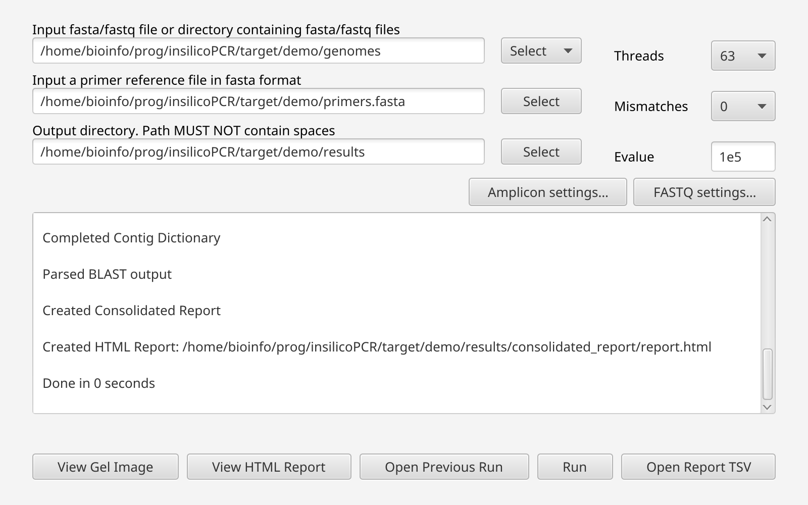

# GUI Overview

The graphical interface is intended for interactive analysis and result review.

The window of version 0.11.0 after a run on a folder of five FASTA files: the three path fields with their **Select** buttons, the run parameters on the right, the two settings buttons, the log, and the action buttons along the bottom.

## Main workflow

The GUI lets users select:

- input FASTA/FASTQ file or directory (**Select ▾** → **File…** or **Folder…**, or drag it onto the field; files and folders are told apart automatically)
- primer FASTA file
- output directory
- number of worker threads
- allowed primer mismatches
- BLAST e-value

Paths can also be typed or pasted into the input, primer and output fields: a leading `~` is your home folder, and a relative path is made absolute.

Two buttons above the log open the remaining settings. Each dialog has **Defaults**, checks values on **OK**, and a ` *` on the button means a value differs from the default; hover the button for a summary.

| Dialog | Settings | Command-line equivalents |
|---|---|---|
| **Amplicon settings…** | probe mismatches (blank = same as primers), 3' window, max 3' penalty, max 5' unaligned bases, min and max amplicon length | `--probe-mismatches`, `--3p-window`, `--3p-penalty`, `--5p-truncation`, `--min-length`, `--max-length` |
| **FASTQ settings…** | Tadpole k-mer length, min k-mer count to seed, min contig coverage, min contig length; min share of informative reads for read-level calls; which assays reads are extended for, to find products longer than a read (unreported, target or off) | `--tadpole-k`, `--tadpole-min-seed`, `--tadpole-min-cov`, `--tadpole-min-contig`, `--read-min-fraction`, `--read-extension` |

See [Amplicon Calling](Amplicon-Calling) and [FASTQ mode and false negatives](Reports#fastq-mode-and-false-negatives) for what they do.

After the inputs are selected, click **Run** to start the analysis. The run first checks every input file (since 0.13.0): a sample with an empty, damaged or malformed file is left out with a `Warning:` line in the log and the other samples are run; see [Input check](Running-Analyses#input-check). **Run** stays disabled until the run ends, so two runs cannot write to the same output folder at once.

## Progress and logs

The application displays progress and log output during the run, including the output of the external tools (BBDuk, Tadpole, BBMerge, BLAST).

The application runs the same pipeline as the command line (since 0.14.0), so FASTQ samples are baited and assembled several at a time, sharing the threads and memory; the log says how (`BBTools: 2 samples at a time, each with 4 threads and -Xmx4g`). To give the application more memory, start it with `JDK_JAVA_OPTIONS=-Xmx96g ./run-insilicoPCR.sh` (on Windows, `set JDK_JAVA_OPTIONS=-Xmx96g` before `run-insilicoPCR.bat`); see [Threads and memory in FASTQ mode](Command-line-Interface#threads-and-memory-in-fastq-mode).

On Linux, starting the launcher from a terminal is recommended because startup messages and errors are also visible in the console.

`QAlog.txt` is rewritten at the end of every run, as on the command line. Closing the window writes `QAlog.txt` and `log.txt` to the output folder of the last run started (nothing is written if no run was started), and stops any external tool still running.

## Post-run actions

| Button | What it does |
|---|---|
| **View Gel Image** | Shows the synthetic gel of the last run started in this window, whatever the output field holds by then |
| **View HTML Report** | Opens the [HTML report](Reports#html-report) of the last run started in this window in your web browser. Enabled once a run has finished; the report of an earlier run is `consolidated_report/report.html` in its output folder |
| **Open Previous Run** | Asks for an earlier run's output folder and shows the gel of its latest consolidated report. The lanes come from the run's own input list in `QAlog.txt`, one per sample: paired FASTQ mates form a single lane and non-sequence files are left out, even if the inputs have since been moved |
| **Open Report TSV** | Asks for any consolidated report `.tsv` and shows it as a gel; lanes are only the samples the report has rows for |

## Synthetic gel viewer

The synthetic gel viewer displays consolidated report results as gel-like bands. See [Synthetic Gel Visualizer](Synthetic-Gel-Visualizer).
