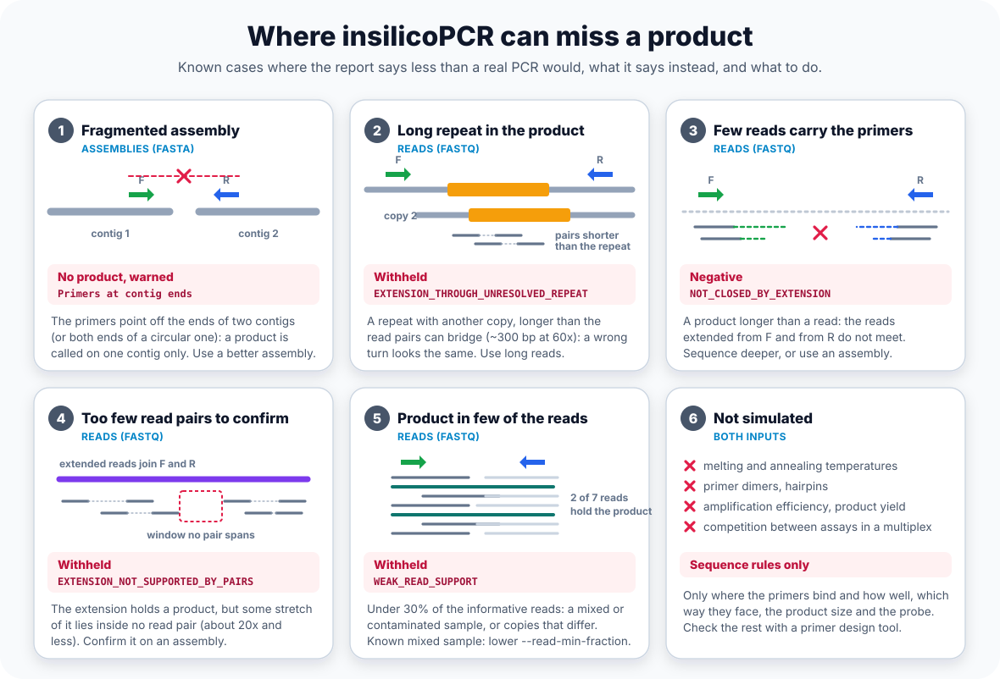

# Limitations

**insilicoPCR applies sequence rules only.** Nothing in it models melting or annealing temperature, primer dimers, hairpins or other secondary structure, amplification efficiency or product yield, or competition between the assays of a multiplex. A product is reported when its primers bind the template within the mismatch budget and the 3'-end rules, face each other on one sequence, lie within the size limits and, for a qPCR assay, have the probe between them ([Amplicon Calling](Amplicon-Calling)). Whether the reaction then works at your annealing temperature is for a primer design tool, such as Primer3, and for the bench.

Within those rules, a few cases make the report say less than a real PCR would. Each is named in the output, so a negative can be told apart from "could not tell".

## Assemblies (FASTA)

**1. Fragmented assembly** (`Primers at contig ends`). A product is called on one contig only. When the assembly breaks between the two primers, they bind on different contigs and no product is reported. Since 0.15.0, when an assay has no product but its primers point off the ends of two contigs, or off both ends of one (a circular plasmid or chromosome cut at its origin), and joining them would give a product within `--max-length`, the run says so: a `Warning:` line in the log and in `QAlog.txt` with the smallest such product, and the sample's cell marked in the HTML report. Use a more complete assembly, or run the reads.

## Reads (FASTQ)

The reads are baited and mini-assembled; an assay the mini-assembly misses is called from the reads themselves, and a product longer than a read is looked for by extending the reads ([FASTQ mode and false negatives](Reports#fastq-mode-and-false-negatives)). What remains is listed, with the reason, in `report_fastq_diagnostics.tsv`:

**2. Long repeat in the product** (`EXTENSION_THROUGH_UNRESOLVED_REPEAT`). The product passes through a repeat that has another copy in the sample and is longer than the read pairs can bridge (about 300 to 350 bp at 60x, 200 to 250 bp at 20x). A real product and a wrong turn into the other copy look the same there, so the product is withheld, real or not. An assembly of long reads settles it.

**3. Few reads carry the primers** (`NOT_CLOSED_BY_EXTENSION`). The product is longer than a read, and too few reads carry the primers for the reads extended from each side to meet. A negative, weaker than one on an assembly. Sequence deeper, or run the assay on an assembly.

**4. Too few read pairs to confirm** (`EXTENSION_NOT_SUPPORTED_BY_PAIRS`). The extended reads hold a product, but some stretch of it lies inside no read pair, or the pairs are too few (about 20x and less). Withheld; confirm it on an assembly.

**5. Product in few of the reads** (`WEAK_READ_SUPPORT`). Complete products are in the reads, but in fewer than 2 or under `--read-min-fraction` (default 30%) of the informative reads (reads carrying a primer at the product's locus): contamination, index hopping, a mixed sample, or a locus of which only some copies match the assay. Withheld and warned about; lower `--read-min-fraction` if the sample is known to be mixed.

With `--read-extension off`, products longer than a read or merged pair (about 580 bp for 2 x 300 bp reads) are not looked for, and such an assay shows as `NOT_IN_READS`.

## Both

**6. Not simulated.** As above: no temperatures, no dimers or hairpins, no efficiency or yield, no multiplex competition. A product the rules accept may still fail in the tube, and the synthetic gel is drawn from the report, not from a simulated reaction ([Synthetic Gel Visualizer](Synthetic-Gel-Visualizer#limitations)).

See also [Why is an amplicon I expected missing from the report?](FAQ#why-is-an-amplicon-i-expected-missing-from-the-report) for products the rules reject on purpose (size limit, 3'-end mismatches, orientation, probe).
