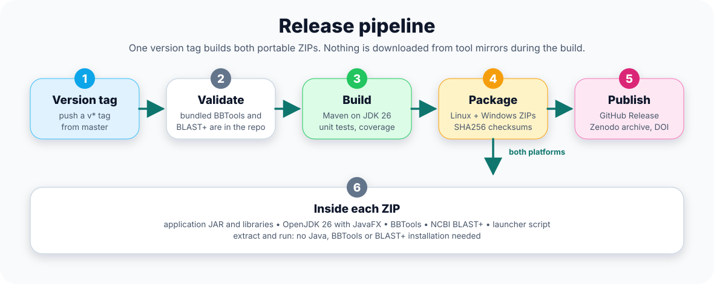

# Release Pipeline

The release process creates deterministic portable ZIP archives for Linux and Windows.



Releases are fully automated: pushing a `v*` tag builds the Linux and Windows portable ZIPs in parallel and publishes them, with their SHA256 checksums, as a GitHub Release, which Zenodo archives with a DOI. Pushes to `master` and pull requests run the same build and tests without publishing.

## CI release flow

1. Check out the repository.
2. Install JDK 26.
3. Validate runtime assets.
4. Build with Maven.
5. Stage the application, libraries, JDK, BBMap, and BLAST+.
6. Create portable ZIP files.
7. Create SHA256 checksum files.
8. Smoke test: run the ZIP that was just built, on Linux and on Windows.
9. Publish release artifacts for version tags.

## Smoke test

`scripts/ci/smoke-test.sh <portable ZIP>` extracts the ZIP and runs its command line with the bundled Java, BLAST+ and BBTools on the [five-isolate example](https://github.com/duceppemo/insilicoPCR/tree/master/docs/examples/five-isolates), two of the five genomes gzipped. It then runs FASTQ mode (BBDuk, BBMerge, Tadpole) on simulated reads of one of the genomes. It fails the build when `report.tsv` differs from the one kept with the example, when the reads do not give the two expected products at their sizes, or when a folder with faulty files (an assembly of header lines only, an empty library, a gzipped FASTQ file cut short) does not end with those files named in warnings, their samples left out and the good sample reported.

The same script checks a downloaded release:

```bash
scripts/ci/smoke-test.sh insilicoPCR-<version>-linux-x64.zip
```

## Linux packaging

```bash
export JAVA_HOME=/path/to/jdk-26
scripts/release/package-linux-portable.sh 0.13.0
```

Expected artifacts:

```text
release/insilicoPCR-<version>-linux-x64.zip
release/insilicoPCR-<version>-linux-x64.zip.sha256
```

## Windows packaging

```powershell
scripts/release-windows.ps1
```

Expected artifacts:

```text
release/insilicoPCR-<version>-windows-x64.zip
release/insilicoPCR-<version>-windows-x64.zip.sha256
```

## Design principle

Release builds should not download BBMap or BLAST+ from external mirrors during CI. The runtime assets are validated from the repository checkout.
