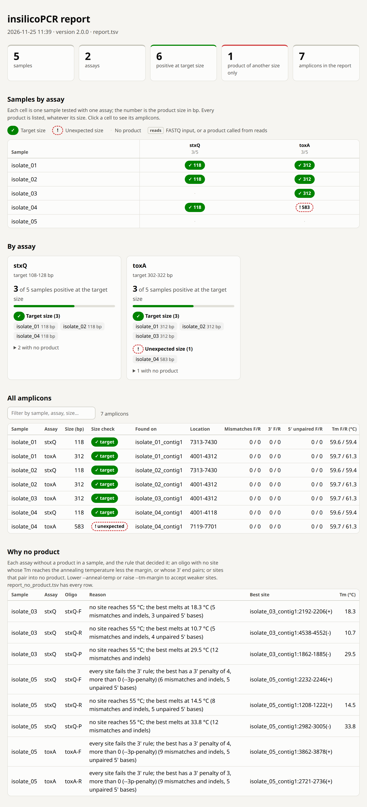

# Reports

insilicoPCR produces report files that summarize primer hits, predicted amplicons, and consolidated results across samples.

## Report types

- runtime and quality logs (`QAlog.txt`): the version, the input files and samples, every setting that decides the results (each with its command-line option: the Tm rule and the reaction it assumes, the 3' rule, product length, BLAST e-value, threads, input check, and the FASTQ settings when there are reads), the versions of the tools used (`Tools:` BLAST+, BBTools, Java; since 0.15.3), the assays sharing a reaction (`mix=`), each oligo's Tm on a perfect match (since 2.0; one below the Tm a site needs is flagged), then what the run found worth a note, and how many assays gave no product in a sample (and, apart, how many made one reported under another assay of their reaction, `mix=`), naming `report_no_product.tsv`. The run's log lists the same settings at its start, and the HTML report under **Run details** (the e-value, threads, input check and Tadpole settings since 0.15.2)
- detailed per-sample BLAST hit tables (`detailed_report/<sample>/<sample>.tsv`)
- consolidated TSV report (`consolidated_report/report.tsv`)
- the samples of the run (`consolidated_report/report_samples.tsv`, since 1.0): every sample, analysed or left out, with its number of products; see [Samples file](#samples-file)
- the assays without a product (`consolidated_report/report_no_product.tsv`, since 2.0): for each sample, each assay that gave no product, and why; see [Assays without a product](#assays-without-a-product)
- HTML report (`consolidated_report/report.html`): the same results as a page to read; see [HTML report](#html-report)
- FASTQ-mode diagnostics (`consolidated_report/report_fastq_diagnostics.tsv`), when any input is FASTQ
- with `--gel`, the synthetic gel as `synthetic_gel_report.png` in the output folder (`synthetic_gel_report(1).png` for `report(1).tsv`); in the application, from its gel viewer

If a `report.tsv` already exists in the output folder, a new run writes `report(1).tsv`, `report(2).tsv`, and so on instead of overwriting it, each with its own log (`QAlog(1).txt`, `QAlog(2).txt`) since 0.15.2. The files of a report are named after it: `report(1).html`, `report(1)_samples.tsv`, `report(1)_no_product.tsv`, `report(1)_fastq_diagnostics.tsv`. `detailed_report/` holds the latest run's files.

## HTML report

Every run writes `report.html` next to `report.tsv` (`report(1).html` next to `report(1).tsv`, and so on). It
is one self-contained file: open it in any browser, offline, or send it to a colleague. It follows the
browser's light or dark theme and prints. It shows exactly the rows of the TSV and hides none (on a run of more
than 10,000 amplicons, "All amplicons" lists the first 10,000, saying so, while the grid and the counts cover every
one, and a click on a grid cell whose rows are past them says `report.tsv` has them: since 0.15.3, before which such a page, millions of rows, could not be opened, or even written; 0.15.3 listed 50,000, a page that took some 40 seconds to open); a printout shows
every row, whatever the filter boxes or a click on a cell left on screen (before 0.15.2 it left out the rows they
hid, without saying so). After a click on a cell, the browser's Back button shows every row again.



The report of a run on five FASTA files with two assays that both declare their product size (the **Run
details** section at the bottom is not shown). `isolate_04` gives the `toxA` product at 583 bp instead of
312 bp: the product is reported and marked as an unexpected size, and the sample is not counted as positive
for that assay. The genomes, the primer file and the report of this run are in the repository under
[`docs/examples/five-isolates`](https://github.com/duceppemo/insilicoPCR/tree/master/docs/examples/five-isolates).

| Section | What it shows |
|---|---|
| Summary | Number of samples, assays and amplicons, and how many sample/assay pairs fall in each outcome below |
| Input not analysed | Only when a file given for a sample is faulty (since 0.13.0): the sample, the file and what is wrong with it. Such a sample is in no other section, as nothing was run on it. See [Input check](Running-Analyses#input-check) |
| Samples by assay | One row per sample, one column per assay, and in each cell the outcome with the product size in bp. Samples without any product are listed too. Each column head gives the number of positive samples. Click a cell to list its amplicons |
| By assay | Per assay: the sizes it declares, how many samples are positive, and their names |
| All amplicons | Every row of the TSV, with a filter box. Since 2.0 it shows each primer's Tm on its site (`Tm F/R (°C)`) and the probe's (`Probe Tm (°C)`) |
| Read-level evidence | FASTQ input only: products called from reads (whole or extended) and products seen in too few reads to be reported |
| Why no product | Since 2.0, only when an assay gave no product in a sample: the oligo without an accepted site, its best site, its Tm, and the rule it fails, as in [`report_no_product.tsv`](#assays-without-a-product) |
| Primers at contig ends | FASTA input only (since 0.15.0): assays with no product whose primers point off the ends of two contigs, or both ends of one, with the smallest product joining them would give. See [Limitations](Limitations#assemblies-fasta) |
| Run details | Version, date, input, primer file, the assays sharing a reaction (`mix=`), every setting that decides the results, and the versions of the tools used (`Tools`), as in `QAlog.txt` |

The outcome of a sample for an assay uses the [product sizes declared in the primer file](Primer-FASTA-Format#declaring-product-sizes-optional), when there are any:

| Mark | Outcome | Meaning |
|---|---|---|
| Solid green, `✓` | Target size | A product of the size the assay is designed to give (`size=`). This is the positive test |
| Solid blue | Amplified | A product of an assay that declares no size: the PCR is positive, and the size is for you to check |
| Amber outline, `≈` | Other known product | Only a product declared as another known size (`other=`) |
| Red dashed outline, `!` | Unexpected size | Only a product of a size the primer file does not declare |
| Dotted outline, `?` | Seen in too few reads | FASTQ input: a complete amplicon is in some reads, too few to report (`WEAK_READ_SUPPORT`) |
| Dashed outline, `⇄` | Not confirmed by read pairs | FASTQ input: extended reads hold a product, but the read pairs do not confirm it; not reported (`EXTENSION_NOT_SUPPORTED_BY_PAIRS`, `EXTENSION_THROUGH_UNRESOLVED_REPEAT`) |
| `◇` | Primers at contig ends | FASTA input: no contig holds a product, but the primers point off the ends of two contigs, or both ends of one, and joined they would give one within `--max-length`. Neither positive nor negative: the assembly may break inside the product, or the sequence may be circular. Check with a more complete assembly, or with the reads |
| `○` | Not checkable from reads | FASTQ input: both primers are in the reads and no product was found, but the reads could not have shown one: with `--read-extension off`, a product of the declared size is longer than a read or merged pair could hold; or the reads extended from the primers loop in a tandem repeat on the way to the product (`EXTENSION_IN_TANDEM_REPEAT`, since 0.15.3). Not a reliable negative; rerun with the [read extension](#read-extension-products-longer-than-a-read) on, or confirm on an assembly (of long reads, for a repeat) or by PCR |
| `·` | No product | |
| `◐` beside the size | A primer binds only partly | Added to any of the outcomes above when every product that decides it has a primer with unaligned 5' bases. The product is reported as usual; whether such a primer anneals in a reaction is for you to judge from the [primer binding columns](#primer-binding-columns) |

A positive PCR is not always a positive test: only a product of the target size is counted as positive for
an assay that declares one. Products of other sizes are never hidden. They are marked, they show as `+1` on a
cell whose main product is the target, and they are all in the amplicon table. Outcomes are told apart by
shape and symbol as well as colour. A small dot on a mark means the product was called from reads rather
than from the mini-assembly.

## Consolidated report


The consolidated report is the primary summary table: one row per predicted amplicon that passed the [amplicon calling rules](Amplicon-Calling). A sample with no product has no row: [`report_samples.tsv`](#samples-file) lists every sample.

### File format

Since 1.0, every report has every column, in one order, whatever the primer file holds; a column that does not apply to a row is empty. The header line is the format:

```text
Sample	Assay	GenomeLocation	AmpliconSize	Contig	ContigDescription	ForwardPrimer	ReversePrimer	ForwardMismatches	ReverseMismatches	Forward3PrimeMismatches	Reverse3PrimeMismatches	Strand	Probe	ProbeLocation	ProbeSize	ProbeMismatches	Forward5PrimeUnpaired	Reverse5PrimeUnpaired	Pairing	Source	SizeCheck	ForwardTm	ReverseTm	ProbeTm
```

Before 1.0, the probe columns were there only when an assay of the primer file had a probe, and `SizeCheck` only when an assay declared a size, so the columns after them moved from one primer file to the next. Columns renamed in 1.0:

| Before 1.0 | Since 1.0 |
|---|---|
| `Gene` | `Assay` |
| `Contig Description` | `ContigDescription` |
| `ForwardPrimers` / `ReversePrimers` | `ForwardPrimer` / `ReversePrimer` |
| `Forward5PrimeUnaligned` / `Reverse5PrimeUnaligned` | `Forward5PrimeUnpaired` / `Reverse5PrimeUnpaired` |

`Pairing` and `Source` are new in 1.0. `ForwardTm`, `ReverseTm` and `ProbeTm` are new in 2.0, after `SizeCheck`: the columns of 1.x keep their places. The application still reads reports written before 1.0, under their old column names (**Open Previous Run**, the gel).

What a script can rely on:

- The file is UTF-8 without a byte-order mark; every line ends in LF (`\n`), on every system; the cells of a line are separated by tabs; the first line is the header.
- A tab or a line break in a value (a FASTA header's description may hold one) is written as a space.
- A cell a spreadsheet would take for a formula (it starts with `=` or `@`, or with `+` or `-` and is not a number: a contig description `=HYPERLINK(...)`, a sample file named `-ctrl.fasta`) is written after an apostrophe, since 0.15.3: `'-ctrl`. Excel and LibreOffice then show the text as it is, where they showed `#NAME?`, or a link to follow. A value that starts with an apostrophe followed by such text gets one more (`'-a` is written `''-a`). To read a cell back, take off a leading apostrophe when the rest of the cell would itself be written after one; the program's own readers (the gel, **Open Previous Run**) do so. A strand `-` and a number such as `-5` are written as they are.
- A value that starts and ends with a double quote (a file named `"isolate 7".fasta`) is quoted as a spreadsheet quotes it: between double quotes, each of its own doubled (`"""isolate 7"""`). To read such a cell back, take off the outer quotes and make each doubled quote one.
- The rows are in this order: by sample name, compared as Java compares strings (character by character, case-sensitive: `ISO2` before `iso1`, and `iso10` before `iso2`); within a sample, first the products found on its sequences (an assembly's contigs, or the mini-assembly of reads), assay by assay in name order, each assay's products in the order they are found (its designed products before those of one primer alone; its primers in primer-file order, a degenerate primer's variants in [their order](Primer-FASTA-Format#degenerate-bases), then BLAST's order of the hits: not by position), then the products of two assays that share a reaction (`mix=`); then, for reads, the products called from reads, then those called by extending reads. The same data and settings give the same order on every run.

### Standard PCR mode columns

| Column | Meaning |
|---|---|
| `Sample` | Sample name (from the input file name) |
| `Assay` | Assay name (primer ID without the `-F`/`-R`/`-P` suffix); for a product of two assays that share a reaction (`mix=`), their names joined by `+` (`stxQ+toxA`), since 0.15.3 |
| `GenomeLocation` | 1-based start-end of the product on the contig; on a circular sequence, a product across its origin starts after it ends (`1780-279`, since 0.15.3) |
| `AmpliconSize` | Product length in bp: both primers in full and the template between their 3' ends. It can differ from the span of `GenomeLocation`: by the length of an insertion or deletion BLAST places inside a primer site, and round a circle's origin, where the location starts after it ends (see [Amplicon Calling](Amplicon-Calling)) |
| `Contig` | Contig/sequence ID the product sits on |
| `ContigDescription` | Free text from the contig FASTA header; for a product called from reads, how the reads support it (below) |
| `ForwardPrimer` / `ReversePrimer` | Primer IDs that formed the pair (degenerate variants keep their `_n` suffix). Since 0.15.3 they can name one role twice (`toxA-F` and `toxA-F`: a product of one primer alone, at an inverted repeat) or two assays (a product of two assays in one reaction); the first is then the primer on the plus strand, and `Pairing` says which it is. The HTML report tags such a product **one primer** or **two assays**, and says why in the cell's hover text. See [Amplicon Calling](Amplicon-Calling#stage-2-amplicon-calling) |
| `ForwardMismatches` / `ReverseMismatches` | Mismatches + indels for each primer, for information: since 2.0 the site's Tm decides, not this count (see [Tm columns](#tm-columns)). The 3' bases BLAST trimmed off its alignment are compared with the template and counted when they do not pair; a 3' base beyond the end of a contig or read counts too. Unpaired 5' bases are not included (see [Primer binding columns](#primer-binding-columns)) |
| `Forward3PrimeMismatches` / `Reverse3PrimeMismatches` | Number of imperfections within the 3'-end window (default last 5 bases) |
| `Strand` | `+` when the forward primer matched the plus strand; `-` when the assay matched the reverse strand |

### qPCR/probe columns

After `Strand`, in every report since 1.0 (before, only when at least one assay in the primer file defined a `-P` probe), and empty on a row without a probe:

| Column | Meaning |
|---|---|
| `Probe` | Probe ID. When the probe binds twice inside a product, the row shows the site with the fewest mismatches, then the one nearest the product's start (since 0.15.3) |
| `ProbeLocation` | 1-based start-end of the probe on the contig (across a circle's origin, as for the product) |
| `ProbeSize` | Length of the probe match |
| `ProbeMismatches` | Mismatches + indels in the probe alignment. A degenerate probe is searched as its variants (`_0`, `_1`, ...); a product has one row, with the variants of primers and probe that match best (since 0.15.2 on contigs, as on reads since 0.13.0; before, on a contig, each variant that hit gave its own row) |

For an assay that defines a probe, a row is only written when the probe lies entirely within the amplicon. Probe-less assays in the same run keep these columns empty.

### Primer binding columns

After the probe columns:

| Column | Meaning |
|---|---|
| `Forward5PrimeUnpaired` / `Reverse5PrimeUnpaired` | Bases among the first 5 of the primer's 5' end that do not pair with the template: the bases BLAST left out of its alignment that differ from the template (bases beyond the end of a contig or read count too), and, since 0.15.3, the mismatches and indels it kept aligned there. Named `Forward5PrimeUnaligned` / `Reverse5PrimeUnaligned` before 1.0 |

These bases are **not** counted in the mismatch columns; differences past them are. A row can therefore show
`0` mismatches for a primer whose first bases do not pair. Whether such a site is accepted is for its Tm to say
(since 2.0; in 1.x, `--5p-truncation` let up to 5 such bases through, whatever the primer's length): 5'
bases that do not pair lower the Tm, and a 17-base primer held by its last 9 bases melts far below 55 °C and is
rejected, while a 22-mer designed at 60 °C with 2 unpaired 5' bases usually still reaches it.

Compare the number with the primer's length, and see `ForwardTm` / `ReverseTm`. The
HTML report gives both numbers (`20 of 22 bases`) and marks such products with `◐`.

### Pairing and source columns

Since 1.0, after the primer binding columns (before, only the primer IDs and the wording of `ContigDescription` told these apart):

| Column | Meaning |
|---|---|
| `Pairing` | How the primers came together: `designed` (an assay's forward primer with its reverse primer), `one-primer` (one role twice: a product of one primer alone) or `two-assays` (primers of two assays that share a reaction, `mix=`). See [Amplicon Calling](Amplicon-Calling#stage-2-amplicon-calling) |
| `Source` | What the product was called on: `assembly` (a contig of an assembly, or of the mini-assembly of reads), `reads` (a read or merged pair: a [read-level call](#read-level-calls)) or `extension` (an extended read: a [read-extension call](#read-extension-products-longer-than-a-read)) |

### Size label column

After `Source` (the last column before 2.0, which added the [Tm columns](#tm-columns) after it). It is filled for the assays that [declare product sizes](Primer-FASTA-Format#declaring-product-sizes-optional) in the primer file (before 1.0 the column was there only when at least one assay declared a size):

| Column | Meaning |
|---|---|
| `SizeCheck` | `target`: the product the assay is designed to give (`size=`). `other`: another product it is known to give (`other=`). `unexpected`: a size the primer file does not declare. Empty for an assay that declares nothing, and for a product of two assays |

The label is information only. Every product is reported whatever its size, with or without a declaration; an `unexpected` row is a product a real PCR would amplify too.

### Tm columns

Since 2.0, after `SizeCheck`. Each oligo's Tm on its site, in °C with one decimal, as the [Tm rule](Amplicon-Calling#tm-on-the-template---anneal-temp---tm-margin) worked it out: Primer3's thermodynamic alignment of the oligo with the template under it, in the reaction the run assumes (`--na`, `--mg`, `--dntp`, `--oligo-conc`). Every reported site reaches its assay's annealing temperature (`--anneal-temp`, or the assay's [`ta=`](Primer-FASTA-Format#annealing-temperature-optional)) less `--tm-margin`: 55 °C by default.

| Column | Meaning |
|---|---|
| `ForwardTm` / `ReverseTm` | Tm of the forward and reverse primer on their sites |
| `ProbeTm` | Tm of the probe on its site; empty for a row without a probe |

A site's Tm is at most the oligo's Tm on a perfect match, which the run's log and `QAlog.txt` list. In the five-isolate example, every site is a perfect match:

```text
Sample      Assay  AmpliconSize  SizeCheck   ForwardTm  ReverseTm  ProbeTm
isolate_01  stxQ   118           target      59.6       59.4       65.0
isolate_01  toxA   312           target      59.7       61.3
```


### Circular sequences

Since 0.15.3, a circular sequence is searched as a circle: a PCR on a plasmid, a mitochondrial genome or a complete chromosome makes the product across its origin, which on the sequence as written is in two pieces, at its two ends. A sequence is circular when

- its FASTA header says so: `circular=true` (Unicycler, Flye, Bakta) or `[topology=circular]` (NCBI's submission tools), in the description after the ID;
- or it is a contig of the FASTQ-mode mini-assembly, of 100 bp or more, that closes on itself: one Tadpole calls a `self-loop`, or one whose end repeats 12 or more of its first bases. Tadpole writes a circle with some of its first bases again at its end, 2 or k - 1 of them on a self-loop; the circle is the contig without them.

A sequence whose header says it is circular is searched as a circle whatever its length.

A product across the origin is reported with its location starting after it ends: on a 3,000-bp plasmid, `2901-100` is 2,901 to 3,000 then 1 to 100, 200 bp. A primer or probe site across the origin is found whole. In the per-sample BLAST table (`detailed_report/<sample>/<sample>.tsv`) such a site ends past the sequence's length (`2989-3012` on a 3,000-bp circle): its positions go on past the origin, where the report gives them on the circle (`2989-12`). A circle is never in the HTML report's *Primers at contig ends* (`◇`): it has no ends.

The mini-assembly builds its contigs on one thread, since 0.15.3: built on several, its contigs differed between runs of the same reads (a circle written from another point, contigs numbered otherwise, now and then one lost or joined), and so did the report. Its k-mers are still loaded on every thread (Tadpole's `buildthreads=1`, with `ways=31`): the same contigs as on one thread throughout. On 9.7 million baited reads it takes 112 s (305 s on one thread throughout, 43 s on 16 threads throughout, with contigs that varied).

## Samples file

Since 1.0, every report has beside it `report_samples.tsv` (`report(1)_samples.tsv` beside `report(1).tsv`): one line per sample of the run, analysed or left out. A sample with no product has no row in `report.tsv`; this file is where a script finds it, as a negative. Before 1.0 only `QAlog.txt` listed the samples.

| Column | Meaning |
|---|---|
| `Sample` | Sample name |
| `Status` | `analysed`, or `not-analysed`: a sample left out for a faulty input file (see [Input check](Running-Analyses#input-check)) |
| `Input` | `assembly` or `reads` |
| `Files` | The sample's file names (not their folders), joined with `; ` |
| `Products` | The number of rows the sample has in `report.tsv`: `0` for an analysed sample with no product. Empty for a sample not analysed, which is neither positive nor negative |
| `Reason` | For a sample not analysed, what is wrong with its files, as in the warning (several joined with `; `); empty otherwise |

The lines are sorted by sample name, in the order of `report.tsv`. The file is written as `report.tsv` is: UTF-8 without a byte-order mark, LF line ends, tabs between cells, and its cells written the same way ([File format](#file-format)).

## Assays without a product

Since 2.0, every report has beside it `report_no_product.tsv` (`report(1)_no_product.tsv` beside `report(1).tsv`): for each sample, each assay that gave no product, and why. `report.tsv` lists what the reactions make; this file, what they do not, and the rule that decided it. The rules are the same for every assay, and an assay may give no product in silico because it is poorly designed, or because its published conditions differ from the run's: this file says which oligo fails, and by how much.

| Column | Meaning |
|---|---|
| `Sample` | Sample name |
| `Assay` | Assay name |
| `Oligo` | The primer or probe with no accepted site (of a degenerate oligo, the variant that came closest). One row per such oligo. Empty when every oligo has a site but none pair into a product |
| `Reason` | Why, in words (below) |
| `BestSite` | The oligo's best site, as `contig:start-end(strand)`; empty when there is none |
| `BestSiteTm` | Its Tm, °C; empty for none, or for a site that fails the 3' rule. One that would round to `NeededTm` is shown 0.1 °C under it (49.98 °C is `49.9` when 50 °C is needed) |
| `NeededTm` | The Tm a site of the assay needs: `--anneal-temp`, or the assay's `ta=`, less `--tm-margin` |

The reasons:

- `no site reaches 55 °C; the best melts at 51.5 °C (2 mismatches and indels, 5 unpaired 5' bases)`: the oligo has sites, all too weak.
- `every site fails the 3' rule; the best has a 3' penalty of 3, more than 0 (--3p-penalty)`: a primer whose sites all have a mismatched 3' end.
- `no site: BLAST found no match`.
- `no site reaches 55 °C, and its Tm on a perfect match is 53.3 °C: it is unlikely to anneal at this temperature (lower the annealing temperature, --anneal-temp or the assay's ta=, or raise --tm-margin)`: the oligo itself is too short or too A/T-rich for the run's temperature, and its assay is unlikely to give a product in any sample. For a degenerate oligo, this is said only when every one of its sequences is below.
- with an empty `Oligo`: `every oligo has a site, but no forward and reverse site face each other on one sequence within 5000 bp (--max-length)`, with `with a probe site between them` for a probe assay.
- with an empty `Oligo`: `its product is reported under a: the two assays share a reaction (mix=) and make it at the same place`: the assay did make its product, and `report.tsv` lists it once, under the other assay of its reaction (see [Primer FASTA Format](Primer-FASTA-Format#assays-in-one-reaction-multiplex)). `QAlog.txt` counts these apart from the assays without a product.

A reason ends with `; the report has a product of one of its primers alone` when `report.tsv` has a product of one of the assay's primers by itself (`Pairing` `one-primer`): a product of the tube, not the one the assay was designed for.

For a FASTQ sample, the reason is about the mini-assembly (`in the mini-assembly (the FASTQ diagnostics say what the reads show)`): see the [diagnostics file](#diagnostics-file) for what the reads show.

From the five-isolate example (`isolate_03` lacks the `stxQ` target; columns `BestSite`, `BestSiteTm`, `NeededTm` left out):

```text
Sample      Assay  Oligo   Reason
isolate_03  stxQ   stxQ-F  no site reaches 55 °C; the best melts at 18.3 °C (5 mismatches and indels, 3 unpaired 5' bases)
isolate_03  stxQ   stxQ-R  no site reaches 55 °C; the best melts at 10.7 °C (5 mismatches and indels, 4 unpaired 5' bases)
isolate_03  stxQ   stxQ-P  no site reaches 55 °C; the best melts at 29.5 °C (12 mismatches and indels)
```

The file is written as `report.tsv` is ([File format](#file-format)). To accept weaker sites, lower `--anneal-temp` (or the assay's `ta=`) or raise `--tm-margin`.

## Detailed per-sample reports

The `detailed_report` folder keeps each sample's BLAST hits that the rules accept (with a header line), the ones its products are made from: useful for auditing a call. Columns follow BLAST `-outfmt "6 qseqid sseqid positive mismatch gaps evalue bitscore slen length qstart qend qseq sstart send sseq"`. Before 0.15.3 it kept every alignment blastn wrote, rejected ones included: 1.5 million lines (140 MB) for one bacterial genome and a 40-assay panel, of which a few thousand were primer sites. A sequence longer than 1 Mb (a chromosome) is searched in overlapping pieces of 1 Mb, since 0.15.3: BLAST's e-value grows with the length of the sequence searched, and on a whole chromosome a primer site with 2 or 3 mismatches could get one above the cut-off and be dropped, though a draft of the same genome kept it. The hits are put back on the sequence, at its own positions, so the table and the report show it whole; each hit comes from the one piece that holds it whole (the pieces share 1,000 bases, each half of the share belonging to one of them).

## FASTQ mode and false negatives

FASTQ input is not assembled into a genome. The reads are baited twice with BBDuk (reads carrying a primer
k-mer, then reads overlapping those of them that hold a primer site the rules accept, found with blastn: since
0.15.3, before which the second baiting started from every read of the first, and with permissive settings took
whole families of rRNA, mitochondrial and repeat reads that share a short k-mer with a primer and hold no site; and
since 0.15.3 those reads are trimmed of adapter read-through and poly-G tails first, an adapter in one baiting every
adapter dimer of the library),
the baited reads are micro-assembled with Tadpole, and the primers are BLASTed against the resulting contigs. The mini-assembly can **omit the target region** or **break inside the
amplicon**, so the forward and reverse primers land on different contigs. Recruitment reaches only so far from
each primer: the reads holding a primer site come with their mates (about one fragment length), and the second
baiting adds the pairs that share a k-mer with one of them, mates included (about one more). A product longer than
the baited reads cover from its two primers cannot be assembled whole, and the longer the product, the more often
the assembly breaks inside it; [read extension](#read-extension-products-longer-than-a-read) baits further, in rounds.
Since 2.0, baiting allows 1 edit (a substitution, an insertion or a deletion) on k-mers shorter than the primers by
5 bases (at least 17 bases, and shorter than the shortest primer; oligos too short for that floor bait in a pass of
their own): the bait takes reads in, and the Tm rule decides. Up to 1.x the edits were `-m` (at most 2), with 3
substitutions on 19-base k-mers at `-m 3`. A primer site with more differences in every k-mer may still bait no read, a
[known gap](Limitations#known-gaps). The diagnostics then list the assay as `PARTIAL_BAIT` when the other primer
baits reads, and not at all when neither does. `PARTIAL_BAIT` also lists an assay whose primer is in the reads at a site
whose Tm is too low, and says so.

### Read-level calls

To catch what the mini-assembly misses, the first-pass reads are also searched directly. Overlapping pairs are
merged with BBMerge, and each read or merged pair is treated as a tiny contig: the primers are BLASTed against it
and the same hit filters, amplicon rules and probe requirement apply. A read only counts when it holds the
**whole** product, both primers included.

A product the assembly did not report is reported from reads when at least **2 reads** (the two reads of one pair count once) hold a complete amplicon
**and** they make up at least **30% of the informative reads**: reads that carry the assay's forward or reverse
primer **at the product's locus** and reach far enough from it to have shown the amplicon. A real target shows in most informative reads
(not all: a sequencing error in a primer or probe can lower a site's Tm below the minimum), while a few
contaminating or index-hopped reads from another library show in few of them. The 30% default comes from the
two read sets in [#7](https://github.com/duceppemo/insilicoPCR/issues/7) (real targets at 68% and 83%, a
contaminant signal at 18%); change it with `--read-min-fraction` (0–1), or in the GUI under **FASTQ settings…**. Raise it for
exclusivity work on runs that may carry contamination, lower it for noisy reads. The value
used is recorded in `QAlog.txt`.

**Which reads are informative.** A primer can match other places in the genome, all the more under permissive
settings (a large `--tm-margin` accepts short partial matches, which a 100 Mb genome holds hundreds of times by
chance). A read carrying the primer at such a place would never have shown the product, so it says
nothing about it. A read is therefore informative only when the bases that follow the primer (up to 30, inside
the product) resemble those of a read holding the product: at most 20% of them may differ. That threshold is
deliberately loose: the reads of a related organism at the same locus still count, and they are what
separates a contaminant from the sample itself. Reads carrying the primer elsewhere are counted apart and
shown in the diagnostics (`… more read(s) carry a primer elsewhere in the genome`). The bases compared run from the
primer to the far end of the shortest product at most, the other primer's site included; when there are fewer
than 10 (a product less than 10 bases longer than the primer), every read carrying a primer counts as
informative.

A low share can also be real biology rather than contamination: in a pooled or outbred sample, or for a
multi-copy gene, only some copies of the locus may match the primers and probe well enough. Such an assay
stays at `WEAK_READ_SUPPORT` under the default; its `ReadDetail` gives the counts to judge by.

**One assay, several products.** When the primers of an assay give amplicons of different sizes in the reads
(the target, and another place where both primers happen to land), each product is called on its own support
and gets its own row, like separate bands on a gel. Sizes within 10 bp of each other are one product: length
variants of a single locus. A product the mini-assembly already reports is not repeated; a product it lacks is
added even when the assembly reports the same assay at another size. Since 2.0, a product the mini-assembly
reports with more primer bases unpaired than the reads show is added too, and its description says so (`in the
mini-assembly only with primer sites that pair less well`). That happens, for example, when a contig ends inside a
primer and the bases it has still give the primer a Tm above the minimum (in 1.x, when `--5p-truncation` let the bases past its end through). Before, the contig's product hid the reads'
product, whose primers pair completely. As everywhere in insilicoPCR, every
product a real PCR would amplify is reported, whatever its size: check `AmpliconSize` against the size the
assay is designed for before calling a test positive (the [`SizeCheck` column](#size-label-column)
does that comparison for you when the primer file declares the size).

Read-level rows appear in `report.tsv` like any other amplicon, with the representative read as `Contig` (its
coordinates are on that read), `Source` `reads`, and a `ContigDescription` starting with `FASTQ read-level call:` and giving the
support, e.g. `complete amplicon in 17 of 25 informative read(s) (68%)`. Reads are counted per DNA fragment:
the two unmerged reads of one pair count once, whether supporting or informative.

Read-level calling only works when an amplicon fits in a read or a merged pair: at most the fragment length
of the library, and no more than about twice the read length minus the overlap BBMerge needs (roughly 580 bp
for 2 x 300 bp reads). The longest amplicon the reads could have held is given as `CheckableLength` in the
diagnostics. A longer amplicon is looked for by extending the reads, described next.

### Read extension: products longer than a read

Since 0.13.0. A product longer than a read or merged pair used to come from the mini-assembly only, and the mini-assembly
often breaks inside high-copy, variable regions such as rDNA: at every position where the copies differ it sees
a branch and stops. For an assay that neither the mini-assembly nor a read reports, **although reads carry both
of its primers**, the reads themselves are therefore extended (which assays exactly is a setting, below):

1. Up to 150 reads carrying the forward primer and up to 150 carrying the reverse primer are taken as seeds,
   spread evenly over the input (all variants of a degenerate primer count as one primer).
2. Tadpole extends each seed both ways through the k-mers (k = 31) of all the baited reads, by up to the maximum
   amplicon length (`-l`; 5000 bases with `-l 0`), and at a branch always follows the better-supported path.
   The baited reads run out about a fragment from each primer, so this is done in rounds (since 0.15.3): while
   an assay has no product closed and its extended reads still grow, the sample's reads sharing a k-mer with the
   last 500 bases at each end of its extended reads are baited, with their mates, and every seed is extended
   again through all the reads baited so far; at most 20 rounds. Before, a product longer than 1.5 to 2 kb never
   closed, however deep the sample. Kept: `_extensionEnds.fasta` (the ends of the last round) and
   `_extensionReads.fastq.gz` (the reads the rounds baited).
3. The extended reads are searched like contigs: same hit filters, amplicon rules and probe requirement.
4. A product must be held by at least **2 extended reads seeded from one primer**, either one. Before 0.15.3 it
   needed 2 from each: at a locus of two products (two alleles, a mixture of strains, paralogs) the reads of one
   primer follow one branch and those of the other the other, and neither product was called. Sizes within 10 bp
   of each other are one product, taken at its most frequent size.
5. Such a product is then **checked against the sample's read pairs**, described below, and reported only when
   they support it over its whole length. Each product reported gets its own row.

Before 0.15.3, the rule was two-sided, 2 extended reads from each primer: it kept out an extension that takes a
wrong branch on its own, which the reads of the other primer, extended the other way, do not follow (on the test
runs a real product was held by 67 to 98% of the extended reads of each side, and such a false join by one read of
one side), but it also kept out both products of a locus of two. A product held from one side only is now called,
and what keeps out a wrong branch, taken from one side or from both, is the read-pair check.

**The read-pair check.** Where two places in the genome share a repeat, an extension can enter the repeat at
one place and leave it at the other, and it does so from both primers alike: both sides then agree on a product
that does not exist. A read pair is one DNA fragment, and no fragment of the sample spans a junction the
sample does not have. So every read of the sample that shares 31 bases with the product is fetched from the
input (not from the baited reads, which thin out away from the primers), each pair is laid on the product, and
two rules are applied:

- **Every window must lie inside read pairs.** For windows of 100, 150, 200 ... bases, the pairs whose
  fragment (from the start of one read to the end of its mate) contains the whole window are counted. The
  largest window is used whose median count is at least 10 and at least 30% of the median count of 100-base
  windows, so that the check adapts to the depth and to the fragment length of the library. The product is
  withheld when some window is held by fewer than 2 pairs, or fewer than 10% of the median, and when even
  100-base windows have a median under 10: too few pairs to tell.
- **No repeat longer than that window.** Pairs cannot bridge a repeat longer than the window they verify:
  every window is then held by fragments of one place or the other, for a real product and for a wrong turn
  alike. Such a repeat is recognised by the reads of its other copy, which match the product over the repeat
  only: many reads start matching at one position and many stop matching at another. The product is then
  withheld, real or not. (A small insertion or deletion in some copies of a locus makes reads stop matching
  from both directions at one position, which is not taken for a repeat.)

On a benchmark of simulated 2 x 250 bp pairs from a bacterial genome edited to hold 19 real products and
repeat traps (a wrong turn through a repeat of 40 to 1000 bp giving the declared size), the extension without
this check reported 1 to 4 false products per run, each held by most of the extended reads of both sides. With
it, it reported none at 60x and at 20x, and found 5 or 6 of the 10 real products that only an extension can
find at 60x, and 3 at 20x. What it costs: real products through a repeat longer than the verified window (300
to 350 bases at 60x, 200 to 250 at 20x) are withheld together with the traps they cannot be told from.

Unpaired reads are their own fragments: the same rules apply, with windows no longer than a read.

Rows called this way have `Source` `extension` and a `ContigDescription` starting with `FASTQ read-extension call:` and giving the
support, e.g. `142 of 150 forward-seeded and 145 of 150 reverse-seeded reads` and `every 150-base window held
by at least 2403 read pairs`. `Contig` is the extended read (`extended_read_<n>`), and the coordinates are on
it. Kept under `detailed_report/<sample>/`: `_extensionSeeds.fasta`, `_extendedReads.fasta`,
`_extendedReads.blast.txt`, and, when a product was checked, `_extensionCandidates.fasta` (the products checked)
and `_extensionCandidateReads.fastq.gz` (the reads fetched for them).

**An extended read is not an assembled consensus.** It is the best-supported path through a locus that can exist
in many slightly different copies, and it can switch from one copy to another along the way. Its **size** is
the result; do not take its sequence as the sequence of the sample. Two length variants of one locus can show
as two close sizes (1072 and 1074 bp for a field population), reported as one product.

What the extension does not do:

- It does not overrule the read-level rules. A product seen in too few reads to report (`WEAK_READ_SUPPORT`)
  stays unreported: the assay is not extended for it, and if the extended reads hold it, it is not added.
- It does not weigh the product against the rest of the sample as the 30% rule does. A product needs 2 extended
  reads seeded from one primer, whatever share of the seeds they are; the counts are in the row for you to judge. A primer
  that also matches elsewhere in the genome gives seeds that never reach the product, which lowers the share
  without meaning anything.
- It needs coverage: with a handful of reads carrying the primers (single juveniles in the test runs) the
  extension stops before joining them, and the assay stays negative with status `NOT_CLOSED_BY_EXTENSION`; with
  too few read pairs on a product (about 20x and less) the check cannot confirm it.
- It cannot confirm a product through a repeat longer than the read pairs can bridge. Such a product is
  withheld with status `EXTENSION_THROUGH_UNRESOLVED_REPEAT`; an assembly of long reads is what settles it.

**Which assays are extended** is set with `--read-extension` (GUI: **FASTQ settings…**, *Extend reads for*):

| Value | Reads are extended for |
|---|---|
| `unreported` (default) | An assay that nothing reports in the sample: no contig and no read holds a product |
| `target` | Those, and an assay that declares a target size (`size=`) of which the sample shows no product yet, whatever other products it shows. Use it when an assay can give a short product somewhere else and its real, long product would otherwise never be looked for |
| `off` | None; long products are then left at `NOT_IN_READS` |

In every case reads must carry both primers, and a product needs 2 extended reads seeded from one primer (rule 4) and the read pairs' support. A product the extended
reads hold at a size the sample already shows (on a contig or in reads, within 10 bp) is not reported a second
time. The extension adds from a few seconds to a few minutes per sample that has such an assay (the read-pair
check reads the input once more when a product needs checking), and nothing otherwise. The value used is recorded in `QAlog.txt` and in the HTML report.

**A FASTQ-mode negative is weaker evidence than a negative on a genome assembly**; for exclusivity or diagnostic
work, confirm negatives on an assembly of the reads.

### Diagnostics file

Every assay the mini-assembly did not report but whose oligos are in the baited reads, and every assay it
reports only at another size than a product called from reads, is listed in
`report_fastq_diagnostics.tsv` (named after the consolidated report, e.g. `report(1)_fastq_diagnostics.tsv`),
summarized in `QAlog.txt`, and noted on the console or in the GUI log. Files kept per sample under
`detailed_report/<sample>/`: `_targetMatches.fastq.gz` (the first baiting: reads sharing a k-mer with a primer),
`_baitAnchors.fastq.gz` (those of them holding a primer site the rules accept, with their mates, since 0.15.3),
`_baitAnchorsTrimmed.fastq.gz` (the anchors with adapter read-through and poly-G tails cut off, each mate on its own:
what the second baiting baits from, since 0.15.3; one anchor ending in a TruSeq adapter baited every adapter dimer of
a library),
`_doubleTargetMatches.fastq.gz` (the second baiting: reads overlapping the anchors), `_assembly.fasta` (the
mini-assembly, searched like an assembly, its hits in `<sample>.tsv`), `_merged.fastq.gz` / `_unmerged.fastq.gz` (BBMerge output, paired-end input only), `_baitedReads.fasta`
(the reads searched, renamed `read_<n>` with the original name as description) and `_baitedReads.blast.txt`
(their BLAST hits the rules accept: since 0.15.3, as in the sample's own table; before, every alignment, half a
million lines for one sample), and, when reads were extended, `_extensionSeeds.fasta`, `_extendedReads.fasta`,
`_extendedReads.blast.txt`, `_extensionCandidates.fasta`, `_extensionCandidateReads.fastq.gz`, `_extensionEnds.fasta`
and `_extensionReads.fastq.gz`.

| Column | Meaning |
|---|---|
| `Sample` / `Assay` | Sample and assay (`Assay` was named `Gene` before 1.0) |
| `Status` | What the reads show; see below |
| `Assembly` | Why the mini-assembly did not report it; see below |
| `ReadsWithForward` / `ReadsWithReverse` / `ReadsWithProbe` | Baited reads (or merged pairs) holding the whole oligo with an accepted hit; every oligo a read carries is counted, and a read matching several variants of a degenerate primer counts once |
| `CheckableLength` | Longest amplicon a read carrying one of the primers could have held |
| `ReadDetail` / `AssemblyDetail` | Details for the two classifications. `ReadDetail` lists each product seen in reads with its support and sizes, strongest first, and the reads set aside for carrying a primer elsewhere in the genome |

| Status | Meaning |
|---|---|
| `CALLED_FROM_READS` | Reported in `report.tsv` from reads |
| `CALLED_BY_EXTENSION` | A product that no contig and no read holds, but at least 2 reads extended from one of its primers do, and that the read pairs support: reported in `report.tsv` (`FASTQ read-extension call`). `ReadDetail` gives the size and the extended reads holding it per side, then any product withheld or held by too few extended reads. With `--read-extension target` the assay can show other products too (`Assembly` is then `OTHER_PRODUCT_ONLY`) |
| `EXTENSION_NOT_SUPPORTED_BY_PAIRS` | Extended reads hold a product, but read pairs do not span one of its windows, or are too few to verify it. **Not reported, and warned about**: this is what a wrong turn through a repeat looks like. `ReadDetail` gives the weakest window, its position and the median |
| `EXTENSION_THROUGH_UNRESOLVED_REPEAT` | Extended reads hold a product that passes through a repeat with another copy in the sample, longer than the read pairs can bridge. **Not reported, and warned about**: a real product and a wrong turn look the same there. `ReadDetail` gives the repeat's position |
| `WEAK_READ_SUPPORT` | Complete amplicons in reads, but fewer than 2 or under `--read-min-fraction` (default 30%) of informative reads. **Not reported, and warned about**: contamination, index hopping, a mixed sample, or a locus of which only some copies match the assay. Inspect the reads before trusting either answer |
| `NOT_IN_READS` | Both primers are in the reads, but no read holds a complete amplicon, and the reads were not extended (`--read-extension off`). Conclusive only for amplicons up to `CheckableLength`; a longer amplicon cannot be ruled out |
| `NOT_CLOSED_BY_EXTENSION` | Both primers are in the reads, no read holds a complete amplicon, and extending the reads did not join the primers (at least 2 extended reads of one primer holding a product). `ReadDetail` gives the number of reads extended and anything seen too few times. A negative, weaker than one on an assembly, especially when few reads carry the primers |
| `EXTENSION_IN_TANDEM_REPEAT` | As `NOT_CLOSED_BY_EXTENSION`, but most of the extended reads end in a tandem repeat ((AT)n, (CAG)n, a VNTR), which they loop in: the extension follows the better-supported branch, and in a repeat longer than a k-mer the repeat's own k-mers outnumber the way out. **Inconclusive**, since 0.15.3 (before, a plain negative): a product through the repeat is neither shown nor ruled out; confirm it on an assembly of long reads, or by PCR. `ReadDetail` names the repeat's unit |
| `PARTIAL_BAIT` | Only some of the assay's primers have a site in the reads that the rules accept. Either the reads carry the primer at a site whose Tm is too low (`ReadDetail` then says the mini-assembly holds a site the rules reject, and `the no-product report gives it and why), or one primer site diverged beyond what the bait matches (1 edit in a k-mer): usually a true negative, sometimes a site an assembly would accept (a [known gap](Limitations#known-gaps)) |

| Assembly | Meaning |
|---|---|
| `NOT_ASSEMBLED` | The forward or reverse primer has no accepted hit on any contig (for `PARTIAL_BAIT` rows, typically the primer missing from the reads too) |
| `SPLIT_ACROSS_CONTIGS` | Both primers hit contigs, never the same one. `AssemblyDetail` lists up to 3 hits per primer (then `+N more`) and each one's distance to the contig end in the primer's extension direction; short distances on both sides mean the assembly broke inside the amplicon |
| `NO_VALID_PAIR` | Both primers share a contig but form no reportable amplicon (orientation, `--min-length`/`--max-length`, or missing probe) |
| `OTHER_PRODUCT_ONLY` | The assembly reports the assay, but only at another size (listed in `AssemblyDetail`); the product in `ReadDetail` was added from reads |
| `LESS_PAIRED_SITES` | The assembly reports the product, but with more primer bases unpaired than the reads show (mismatches, or 5' bases past a contig end); the product in `ReadDetail` was added from reads too. Since 2.0: before, the contig's product hid the reads' |

`QAlog.txt` also records the Tadpole settings used. The command-line options `--tadpole-k`,
`--tadpole-min-seed`, `--tadpole-min-cov` and `--tadpole-min-contig`, or **FASTQ settings…** in the GUI, tune
the mini-assembly; the defaults
(`k=31 mincountseed=2 mincov=1 mincontig=60`) are less strict than Tadpole's own (`mincountseed=3
mincontig=500`), which drops contigs spanning short amplicons.

## Mode behavior

The probe requirement is decided per assay (since version 0.8.0): assays with a `-P` probe require probe support inside the amplicon, while probe-less assays are reported on their primer pair alone — both can live in the same primer FASTA file. See [Standard PCR vs qPCR](Standard-PCR-vs-qPCR).

## Synthetic gel

The synthetic gel visualizer reads consolidated result data and displays predicted amplicons as gel-like bands. See [Synthetic Gel Visualizer](Synthetic-Gel-Visualizer).
