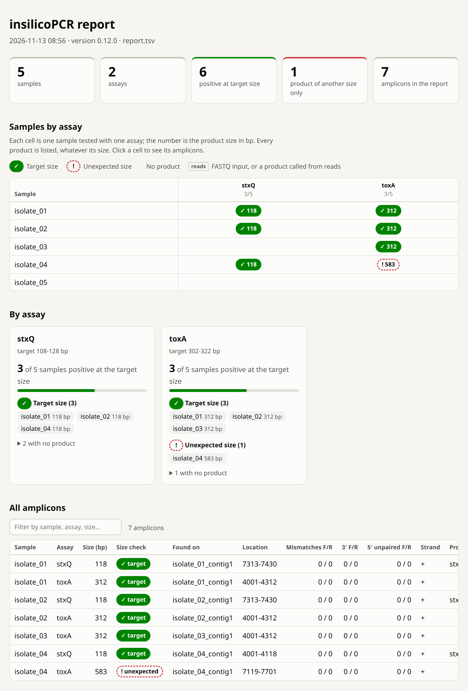

# Reports

insilicoPCR produces report files that summarize primer hits, predicted amplicons, and consolidated results across samples.

## Report types

- runtime and quality logs (`QAlog.txt`)
- detailed per-sample BLAST hit tables (`detailed_report/<sample>/<sample>.tsv`)
- consolidated TSV report (`consolidated_report/report.tsv`)
- HTML report (`consolidated_report/report.html`): the same results as a page to read; see [HTML report](#html-report)
- FASTQ-mode diagnostics (`consolidated_report/report_fastq_diagnostics.tsv`), when any input is FASTQ
- synthetic gel images rendered from the consolidated report

If a `report.tsv` already exists in the output folder, a new run writes `report(1).tsv`, `report(2).tsv`, and so on instead of overwriting it.

## HTML report

Every run writes `report.html` next to `report.tsv` (`report(1).html` next to `report(1).tsv`, and so on). It
is one self-contained file: open it in any browser, offline, or send it to a colleague. It follows the
browser's light or dark theme and prints. It shows exactly the rows of the TSV and hides none.



The report of a run on five FASTA files with two assays that both declare their product size (the **Run
details** section at the bottom is not shown). `isolate_04` gives the `toxA` product at 583 bp instead of
312 bp: the product is reported and marked as an unexpected size, and the sample is not counted as positive
for that assay. The genomes, the primer file and the report of this run are in the repository under
[`docs/examples/five-isolates`](https://github.com/duceppemo/insilicoPCR/tree/master/docs/examples/five-isolates).

| Section | What it shows |
|---|---|
| Summary | Number of samples, assays and amplicons, and how many sample/assay pairs fall in each outcome below |
| Input not analysed | Only when a file given for a sample is faulty (since 0.13.0): the sample, the file and what is wrong with it. Such a sample is in no other section, as nothing was run on it. See [Input check](Running-Analyses#input-check) |
| Samples by assay | One row per sample, one column per assay, and in each cell the outcome with the product size in bp. Samples without any product are listed too. Each column head gives the number of positive samples. Click a cell to list its amplicons |
| By assay | Per assay: the sizes it declares, how many samples are positive, and their names |
| All amplicons | Every row of the TSV, with a filter box |
| Read-level evidence | FASTQ input only: products called from reads and products seen in too few reads to be reported |
| Run details | Version, date, input, primer file and the amplicon settings used |

The outcome of a sample for an assay uses the [product sizes declared in the primer file](Primer-FASTA-Format#declaring-product-sizes-optional), when there are any:

| Mark | Outcome | Meaning |
|---|---|---|
| Solid green, `✓` | Target size | A product of the size the assay is designed to give (`size=`). This is the positive test |
| Solid blue | Amplified | A product of an assay that declares no size: the PCR is positive, and the size is for you to check |
| Amber outline, `≈` | Other known product | Only a product declared as another known size (`other=`) |
| Red dashed outline, `!` | Unexpected size | Only a product of a size the primer file does not declare |
| Dotted outline, `?` | Seen in too few reads | FASTQ input: a complete amplicon is in some reads, too few to report (`WEAK_READ_SUPPORT`) |
| `○` | Not checkable from reads | FASTQ input: both primers are in the reads, no product was found, and a product of the declared size is longer than a read or merged pair could hold. Not a reliable negative; confirm on an assembly |
| `·` | No product | |
| `◐` beside the size | A primer binds only partly | Added to any of the outcomes above when every product that decides it has a primer with unaligned 5' bases. The product is reported as usual; whether such a primer anneals in a reaction is for you to judge from the [primer binding columns](#primer-binding-columns) |

A positive PCR is not always a positive test: only a product of the target size is counted as positive for
an assay that declares one. Products of other sizes are never hidden. They are marked, they show as `+1` on a
cell whose main product is the target, and they are all in the amplicon table. Outcomes are told apart by
shape and symbol as well as colour. A small dot on a mark means the product was called from reads rather
than from the mini-assembly.

## Consolidated report

The consolidated report is the primary summary table: one row per predicted amplicon that passed the [amplicon calling rules](Amplicon-Calling).

### Standard PCR mode columns

| Column | Meaning |
|---|---|
| `Sample` | Sample name (from the input file name) |
| `Gene` | Assay name (primer ID without the `-F`/`-R`/`-P` suffix) |
| `GenomeLocation` | 1-based start-end of the product on the contig |
| `AmpliconSize` | Product length in bp, primers included |
| `Contig` | Contig/sequence ID the product sits on |
| `Contig Description` | Free text from the contig FASTA header |
| `ForwardPrimers` / `ReversePrimers` | Primer IDs that formed the pair (degenerate variants keep their `_n` suffix) |
| `ForwardMismatches` / `ReverseMismatches` | Mismatches + indels for each primer, as counted against `-m`. The 3' bases BLAST trimmed off its alignment are compared with the template and counted when they do not pair; a 3' base beyond the end of a contig or read counts too. Unpaired 5' bases are not included (see [Primer binding columns](#primer-binding-columns)) |
| `Forward3PrimeMismatches` / `Reverse3PrimeMismatches` | Number of imperfections within the 3'-end window (default last 5 bases) |
| `Strand` | `+` when the forward primer matched the plus strand; `-` when the assay matched the reverse strand |

### qPCR/probe columns

When at least one assay in the primer file defines a `-P` probe, the report appends:

| Column | Meaning |
|---|---|
| `Probe` | Probe ID |
| `ProbeLocation` | 1-based start-end of the probe on the contig |
| `ProbeSize` | Length of the probe match |
| `ProbeMismatches` | Mismatches + indels in the probe alignment |

For an assay that defines a probe, a row is only written when the probe lies entirely within the amplicon. Probe-less assays in the same run keep these columns empty.

### Primer binding columns

After the columns above (and the probe columns, when present):

| Column | Meaning |
|---|---|
| `Forward5PrimeUnaligned` / `Reverse5PrimeUnaligned` | Bases at the 5' end of the primer that do not pair with the template: of the bases BLAST left out of its alignment, the ones that differ from the template (bases beyond the end of a contig or read count too) |

The bases BLAST left out are allowed up to `--5p-truncation` (default 5), whether they pair or not, and are **not** counted in the mismatch columns.
A row can therefore show `0` mismatches for a primer that is held by its 3' end only. With
`--5p-truncation 8`, a 17-base primer is accepted on a 9-base match:

```text
ForwardPrimers  ForwardMismatches  Forward3PrimeMismatches  Forward5PrimeUnaligned
assay-F         0                  0                        8
```

Compare the number with the primer's length. Six unaligned bases of a 22-mer leave 16 bound, which a
reaction tolerates; eight of a 17-mer leave 9, which will not anneal at a normal annealing temperature. The
HTML report gives both numbers (`9 of 17 bases`) and marks such products with `◐`.

### Size label column

When at least one assay in the primer file [declares product sizes](Primer-FASTA-Format#declaring-product-sizes-optional), the report ends with:

| Column | Meaning |
|---|---|
| `SizeCheck` | `target`: the product the assay is designed to give (`size=`). `other`: another product it is known to give (`other=`). `unexpected`: a size the primer file does not declare. Empty for an assay that declares nothing |

The label is information only. Every product is reported whatever its size, with or without a declaration; an `unexpected` row is a product a real PCR would amplify too.

## Detailed per-sample reports

The `detailed_report` folder keeps the raw BLAST tabular output per sample (with a header line), useful for auditing why a primer hit was or was not accepted. Columns follow BLAST `-outfmt "6 qseqid sseqid positive mismatch gaps evalue bitscore slen length qstart qend qseq sstart send sseq"`.

## FASTQ mode and false negatives

FASTQ input is not assembled into a genome. The reads are baited twice with BBDuk (reads carrying a primer
k-mer, then reads overlapping those), the baited reads are micro-assembled with Tadpole, and the primers are
BLASTed against the resulting contigs. The mini-assembly can **omit the target region** or **break inside the
amplicon**, so the forward and reverse primers land on different contigs. Recruitment only reaches about one
fragment length beyond each primer, so amplicons longer than roughly two fragment lengths always end up split.

### Read-level calls

To catch what the mini-assembly misses, the first-pass reads are also searched directly. Overlapping pairs are
merged with BBMerge, and each read or merged pair is treated as a tiny contig: the primers are BLASTed against it
and the same hit filters, amplicon rules and probe requirement apply. A read only counts when it holds the
**whole** product, both primers included.

A product the assembly did not report is reported from reads when at least **2 reads** (the two reads of one pair count once) hold a complete amplicon
**and** they make up at least **30% of the informative reads**: reads that carry the assay's forward or reverse
primer **at the product's locus** and reach far enough from it to have shown the amplicon. A real target shows in most informative reads
(not all: a sequencing error in a primer or probe disqualifies a read under a strict `-m`), while a few
contaminating or index-hopped reads from another library show in few of them. The 30% default comes from the
two read sets in [#7](https://github.com/duceppemo/insilicoPCR/issues/7) (real targets at 68% and 83%, a
contaminant signal at 18%); change it with `--read-min-fraction` (0–1), or in the GUI under **FASTQ settings…**. Raise it for
exclusivity work on runs that may carry contamination, lower it for noisy reads under a strict `-m`. The value
used is recorded in `QAlog.txt`.

**Which reads are informative.** A primer can match other places in the genome, all the more under permissive
settings (`-m 1 --5p-truncation 8` accepts a 12-base match of a 20-mer, which a 100 Mb genome holds hundreds of
times by chance). A read carrying the primer at such a place would never have shown the product, so it says
nothing about it. A read is therefore informative only when the bases that follow the primer (up to 30, inside
the product) resemble those of a read holding the product: at most 20% of them may differ. That threshold is
deliberately loose: the reads of a related organism at the same locus still count, and they are what
separates a contaminant from the sample itself. Reads carrying the primer elsewhere are counted apart and
shown in the diagnostics (`… more read(s) carry a primer elsewhere in the genome`). When too few bases lie
between the primers to compare (under 10), every read carrying a primer counts as informative.

A low share can also be real biology rather than contamination: in a pooled or outbred sample, or for a
multi-copy gene, only some copies of the locus may match the primers and probe within the mismatch budget. Such an assay
stays at `WEAK_READ_SUPPORT` under the default; its `ReadDetail` gives the counts to judge by.

**One assay, several products.** When the primers of an assay give amplicons of different sizes in the reads
(the target, and another place where both primers happen to land), each product is called on its own support
and gets its own row, like separate bands on a gel. Sizes within 10 bp of each other are one product: length
variants of a single locus. A product the mini-assembly already reports is not repeated; a product it lacks is
added even when the assembly reports the same assay at another size. As everywhere in insilicoPCR, every
product a real PCR would amplify is reported, whatever its size: check `AmpliconSize` against the size the
assay is designed for before calling a test positive (the optional [`SizeCheck` column](#size-label-column)
does that comparison for you).

Read-level rows appear in `report.tsv` like any other amplicon, with the representative read as `Contig` (its
coordinates are on that read) and a `Contig Description` starting with `FASTQ read-level call:` and giving the
support, e.g. `complete amplicon in 17 of 25 informative read(s) (68%)`. Reads are counted per DNA fragment:
the two unmerged reads of one pair count once, whether supporting or informative.

Read-level calling only works when an amplicon fits in a read or a merged pair: at most the fragment length
of the library, and no more than about twice the read length minus the overlap BBMerge needs (roughly 580 bp
for 2 x 300 bp reads). A longer amplicon can only come from the mini-assembly, which often breaks inside
high-copy regions such as rDNA; its `NOT_IN_READS` row states the longest amplicon the reads could have held
(`CheckableLength`). **A FASTQ-mode negative is weaker
evidence than a negative on a genome assembly**; for exclusivity or diagnostic work, and for assays with
amplicons longer than the fragments, confirm negatives on an assembly of the reads.

### Diagnostics file

Every assay the mini-assembly did not report but whose oligos are in the baited reads, and every assay it
reports only at another size than a product called from reads, is listed in
`report_fastq_diagnostics.tsv` (named after the consolidated report, e.g. `report(1)_fastq_diagnostics.tsv`),
summarized in `QAlog.txt`, and noted on the console or in the GUI log. Files kept per sample under
`detailed_report/<sample>/`: `_merged.fastq.gz` / `_unmerged.fastq.gz` (BBMerge output, paired-end input only), `_baitedReads.fasta`
(the reads searched, renamed `read_<n>` with the original name as description) and `_baitedReads.blast.txt`
(their BLAST hits).

| Column | Meaning |
|---|---|
| `Sample` / `Gene` | Sample and assay |
| `Status` | What the reads show; see below |
| `Assembly` | Why the mini-assembly did not report it; see below |
| `ReadsWithForward` / `ReadsWithReverse` / `ReadsWithProbe` | Baited reads (or merged pairs) holding the whole oligo with an accepted hit; every oligo a read carries is counted, and a read matching several variants of a degenerate primer counts once |
| `CheckableLength` | Longest amplicon a read carrying one of the primers could have held |
| `ReadDetail` / `AssemblyDetail` | Details for the two classifications. `ReadDetail` lists each product seen in reads with its support and sizes, strongest first, and the reads set aside for carrying a primer elsewhere in the genome |

| Status | Meaning |
|---|---|
| `CALLED_FROM_READS` | Reported in `report.tsv` from reads |
| `WEAK_READ_SUPPORT` | Complete amplicons in reads, but fewer than 2 or under `--read-min-fraction` (default 30%) of informative reads. **Not reported, and warned about**: contamination, index hopping, a mixed sample, or a locus of which only some copies match the assay. Inspect the reads before trusting either answer |
| `NOT_IN_READS` | Both primers are in the reads, but no read holds a complete amplicon. Conclusive only for amplicons up to `CheckableLength`; a longer amplicon cannot be ruled out |
| `PARTIAL_BAIT` | Only some of the assay's primers are in the reads (e.g. one primer site diverged beyond `-m`); usually a true negative |

| Assembly | Meaning |
|---|---|
| `NOT_ASSEMBLED` | The forward or reverse primer has no accepted hit on any contig (for `PARTIAL_BAIT` rows, typically the primer missing from the reads too) |
| `SPLIT_ACROSS_CONTIGS` | Both primers hit contigs, never the same one. `AssemblyDetail` lists up to 3 hits per primer (then `+N more`) and each one's distance to the contig end in the primer's extension direction; short distances on both sides mean the assembly broke inside the amplicon |
| `NO_VALID_PAIR` | Both primers share a contig but form no reportable amplicon (orientation, `--min-length`/`--max-length`, or missing probe) |
| `OTHER_PRODUCT_ONLY` | The assembly reports the assay, but only at another size (listed in `AssemblyDetail`); the product in `ReadDetail` was added from reads |

`QAlog.txt` also records the Tadpole settings used. The command-line options `--tadpole-k`,
`--tadpole-min-seed`, `--tadpole-min-cov` and `--tadpole-min-contig`, or **FASTQ settings…** in the GUI, tune
the mini-assembly; the defaults
(`k=31 mincountseed=2 mincov=1 mincontig=60`) are less strict than Tadpole's own (`mincountseed=3
mincontig=500`), which drops contigs spanning short amplicons.

## Mode behavior

The probe requirement is decided per assay (since version 0.8.0): assays with a `-P` probe require probe support inside the amplicon, while probe-less assays are reported on their primer pair alone — both can live in the same primer FASTA file. See [Standard PCR vs qPCR](Standard-PCR-vs-qPCR).

## Synthetic gel

The synthetic gel visualizer reads consolidated result data and displays predicted amplicons as gel-like bands. See [Synthetic Gel Visualizer](Synthetic-Gel-Visualizer).
