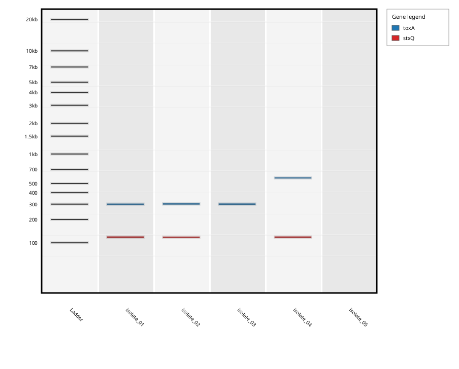

# Synthetic Gel Visualizer

The synthetic gel visualizer displays consolidated PCR results as gel-like bands.

It is intended as a quick visual review tool for expected amplicon size patterns across samples and targets.

Each lane is a sample and each band an amplicon of the consolidated report, coloured by assay, next to a size ladder. In this example (five FASTA files, two assays, exported with `--gel`), `isolate_01` to `isolate_03` give the `toxA` product at 312 bp, `isolate_04` gives it at 583 bp, a product of another size that the report lists like any other, and `isolate_05` gives no product: its lane is loaded but empty.

## What it uses

The visualizer reads consolidated report data produced by an insilicoPCR run.

It uses information such as:

- sample name
- target or assay name
- amplicon size
- report rows from the consolidated report

## When to use it

Use the synthetic gel visualizer to:

- inspect whether expected amplicon sizes are present
- compare band patterns across samples
- quickly spot unexpected amplicon sizes
- produce a gel-style image for review or discussion

## Opening the gel viewer

After a GUI run finishes, use the gel viewer button in the application.

The application can also open previous run folders or consolidated report TSV files when available.

A run of more than 100 samples is shown 100 samples (one gel) at a time: **Previous gel** and **Next gel** (or Page Up and Page Down) turn the pages, and a search that finds nothing on the gel shown turns to the first gel with a match. Every gel has the same tools: band selection, search, colours, zoom and saving (the current gel, as `synthetic_gel_report_page_002.png` and so on). Before 0.15.2, such a run opened a simpler viewer, without selection or the band menu, that drew its bands differently. `--gel` pages a run the same way: one picture per 100 samples, `synthetic_gel_report_page_001.png` and on (before 0.15.2, one picture of every lane, too large for a run of a few hundred samples).

**Color** draws the bands in black, as on a stained gel, **By gene** (each band in its assay's colour, with a gene legend; the `--gel` picture is drawn this way) or **By size check**. By size check, each band shows what its size is for its assay, as the report's `SizeCheck` column says when the primer file declares sizes (see [Declaring product sizes](Primer-FASTA-Format#declaring-product-sizes-optional)): green for the target size, amber for another known product (`other=`), red for an unexpected size, and blue for an assay that declares no size ("Amplified", as the HTML report names it), with a legend of those shown. Coloured, products of one size that differ in what colours them, which run together on a gel and are drawn as one band in black, are drawn as one band each, 3 px apart, so that no colour hides another. Changing the colours lets go of the selection.

The hover text and band details give each product's size check (`Size check: unexpected`), and the search finds it: searching `unexpected` shows the products of a size the primer file does not declare, and Ctrl+A then selects those of the gel shown. On a run of several gels, the count says how many match on the gel shown and on all gels (`2 matches on this gel, 7 on all gels`), counting bands as the gel shown draws them, and a search with no match on the gel shown turns to the first gel with one. Nothing is left out: every product is drawn, whatever its size. Before 0.15.2 the gel did not read the size check: a product of the wrong size looked like any other band.

Opening the viewer writes nothing. **Save PNG...**, **Save SVG...** and **Save PDF...** save the gel shown as `--gel` draws it: the whole gel at its own size, whatever the zoom or the window's size, with the band colours shown and their legend, but without the hover and selection outlines or the fading of bands a search does not match (before 0.15.2, PNG and PDF were a snapshot of the window with those, SVG was not, and none had the legend). They offer `synthetic_gel_<report>.png` (`.svg`, `.pdf`) in the run's output folder, the name `--gel` writes (`synthetic_gel_report(1).png` for `report(1).tsv`). Before 0.15.1 the viewer saved a PNG under that name each time it opened, replacing a `--gel` picture, and could not open a run in a folder it could not write to.

## Interpretation

Each displayed band represents a predicted PCR amplicon from the consolidated report.

The visualizer is not a replacement for reviewing the detailed reports. It is a visual summary of the report data.

Always confirm important results in the detailed or consolidated report tables.

For a view that names the positive samples and compares each product with the size the assay is designed to give, open the [HTML report](Reports#html-report) of the run (**View HTML Report**).

## Standard PCR vs qPCR mode

The gel visualizer depends on the consolidated report.

The gel shows exactly what the consolidated report contains. For an assay that defines a `-P` probe, a band appears only when the probe was also found inside the amplicon; probe-less assays produce bands from their primer pair alone (mixed runs are supported since version 0.8.0).

## Limitations

The synthetic gel is a visualization of predicted results. It does not simulate every physical property of a real electrophoresis gel.

It should be used for review and communication, not as the only source of interpretation.

## Recommended workflow

1. Run insilicoPCR.
2. Review the console/log output for errors.
3. Review detailed and consolidated reports.
4. Open the synthetic gel visualizer.
5. Use the gel view to compare amplicon patterns across samples.
6. Export or capture the gel view if needed for documentation.
