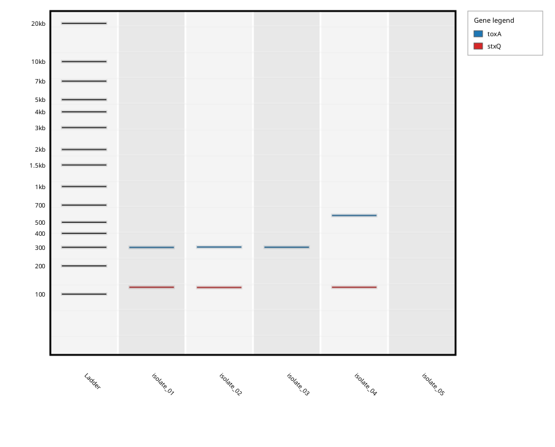

# Synthetic Gel Visualizer

The synthetic gel visualizer displays consolidated PCR results as gel-like bands.

It is intended as a quick visual review tool for expected amplicon size patterns across samples and targets.

Each lane is a sample and each band an amplicon of the consolidated report, coloured by assay, next to a size ladder. In this example (five FASTA files, two assays, exported with `--gel`), `isolate_01` to `isolate_03` give the `toxA` product at 312 bp, `isolate_04` gives it at 583 bp, a product of another size that the report lists like any other, and `isolate_05` gives no product: its lane is loaded but empty.

## What it uses

The visualizer reads consolidated report data produced by an insilicoPCR run.

It uses information such as:

- sample name
- target or assay name
- amplicon size
- report rows from the consolidated report

## When to use it

Use the synthetic gel visualizer to:

- inspect whether expected amplicon sizes are present
- compare band patterns across samples
- quickly spot unexpected amplicon sizes
- produce a gel-style image for review or discussion

## Opening the gel viewer

After a GUI run finishes, use the gel viewer button in the application.

The application can also open previous run folders or consolidated report TSV files when available.

## Interpretation

Each displayed band represents a predicted PCR amplicon from the consolidated report.

The visualizer is not a replacement for reviewing the detailed reports. It is a visual summary of the report data.

Always confirm important results in the detailed or consolidated report tables.

For a view that names the positive samples and compares each product with the size the assay is designed to give, open the [HTML report](Reports#html-report) of the run (**View HTML Report**).

## Standard PCR vs qPCR mode

The gel visualizer depends on the consolidated report.

The gel shows exactly what the consolidated report contains. For an assay that defines a `-P` probe, a band appears only when the probe was also found inside the amplicon; probe-less assays produce bands from their primer pair alone (mixed runs are supported since version 0.8.0).

## Limitations

The synthetic gel is a visualization of predicted results. It does not simulate every physical property of a real electrophoresis gel.

It should be used for review and communication, not as the only source of interpretation.

## Recommended workflow

1. Run insilicoPCR.
2. Review the console/log output for errors.
3. Review detailed and consolidated reports.
4. Open the synthetic gel visualizer.
5. Use the gel view to compare amplicon patterns across samples.
6. Export or capture the gel view if needed for documentation.
