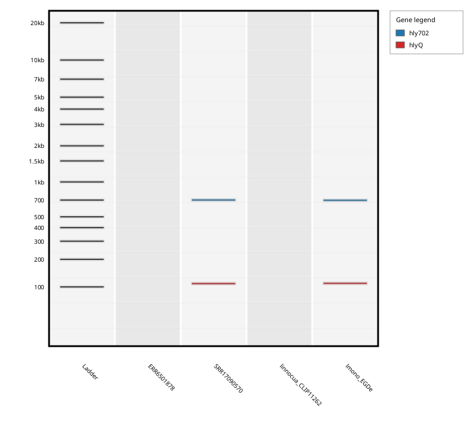

# Tutorial: Mixed PCR + qPCR Run with Controls

This tutorial walks through a complete, realistic insilicoPCR run using **public data you download yourself** — no synthetic sequences. In one single run it combines:

- a **conventional PCR assay** and a **TaqMan qPCR assay** in the same primer file (mixed mode),
- a **genome assembly** (FASTA) and **raw Illumina reads** (FASTQ) as inputs,
- a **positive control** (*Listeria monocytogenes*) and a **negative control** (*Listeria innocua*, the classic *hly*-negative near-neighbor used for exclusivity testing).

Everything below uses the command line from an extracted portable release; the same inputs work in the GUI.

## 1. The assays

Both assays target *hly* (listeriolysin O, *hlyA*), which is present in *L. monocytogenes* and absent from *L. innocua*:

| Assay | Type | Expected product |
|---|---|---|
| `hly702` | conventional PCR (F + R) | 702 bp |
| `hlyQ` | TaqMan qPCR (F + R + probe) | 112 bp |

The `hlyQ` primers and probe are the *hlyA*-177 5'-nuclease assay of [Nogva et al. 2000, *Appl Environ Microbiol* 66:4266–4271](https://doi.org/10.1128/AEM.66.10.4266-4271.2000) (sequences as tabulated by [Iwaniak et al. 2017, *J Vet Res*](https://doi.org/10.1515/jvetres-2017-0069)); the `hly702` pair is a widely used conventional *hlyA* primer set (as tabulated, e.g., in [this virulence-gene primer table](https://pmc.ncbi.nlm.nih.gov/articles/PMC9272080/table/table002)).

Save this as `listeria_assays.fasta`:

```fasta
>hly702-F
CCTAAGACGCCAATCGAA
>hly702-R
AAGCGCTTGCAACTGCTC
>hlyQ-F
TGCAAGTCCTAAGACGCCA
>hlyQ-R
CACTGCATCTCCGTGGTATACTAA
>hlyQ-P
CGATTTCATCCGCGTGTTTCTTTTCG
```

Note the naming convention: `-F`/`-R`/`-P` suffixes group primers into assays, and the probe-less `hly702` assay can share the file with the probe-based `hlyQ` assay — the probe requirement is applied per assay (see [Standard PCR vs qPCR](Standard-PCR-vs-qPCR)).

## 2. Download the public data (~100 MB total)

```bash
mkdir -p tutorial_input && cd tutorial_input

# Positive control assembly: L. monocytogenes EGD-e reference genome (NCBI)
curl -L -o lmono_EGDe.fasta.gz "https://ftp.ncbi.nlm.nih.gov/genomes/all/GCF/000/196/035/GCF_000196035.1_ASM19603v1/GCF_000196035.1_ASM19603v1_genomic.fna.gz"

# Negative control assembly: L. innocua Clip11262 reference genome (NCBI)
curl -L -o linnocua_CLIP11262.fasta.gz "https://ftp.ncbi.nlm.nih.gov/genomes/all/GCF/000/195/795/GCF_000195795.1_ASM19579v1/GCF_000195795.1_ASM19579v1_genomic.fna.gz"
gunzip *.gz

# Positive control reads: L. monocytogenes Illumina WGS run SRR17090570 (ENA, ~52 MB)
curl -L -O "https://ftp.sra.ebi.ac.uk/vol1/fastq/SRR170/070/SRR17090570/SRR17090570_1.fastq.gz"
curl -L -O "https://ftp.sra.ebi.ac.uk/vol1/fastq/SRR170/070/SRR17090570/SRR17090570_2.fastq.gz"

# Negative control reads: L. innocua Illumina WGS run ERR6501878 (ENA, ~39 MB)
curl -L -O "https://ftp.sra.ebi.ac.uk/vol1/fastq/ERR650/008/ERR6501878/ERR6501878_1.fastq.gz"
curl -L -O "https://ftp.sra.ebi.ac.uk/vol1/fastq/ERR650/008/ERR6501878/ERR6501878_2.fastq.gz"

cd ..
```

The `_1`/`_2` FASTQ pairs are automatically grouped into one paired-end sample each, and the FASTQ compression is handled transparently.

## 3. Run insilicoPCR

From the extracted portable release folder:

```bash
./runtime/linux/jdk/bin/java -jar insilicoPCR.jar \
  -i tutorial_input/ \
  -p listeria_assays.fasta \
  -o tutorial_results/ \
  -t 8 \
  --gel
```

What happens, per sample:

- the two **assemblies** are BLASTed directly against the primer database;
- the two **read sets** are first baited twice with BBDuk and micro-assembled with Tadpole, and the resulting contigs are BLASTed;
- accepted hits are paired into amplicons (convergent orientation, ≤ 5000 bp by default, perfect 3' ends — see [Amplicon Calling](Amplicon-Calling));
- `--gel` additionally renders the synthetic gel image (requires a graphical environment).

The run takes well under a minute on a desktop machine.

## 4. The consolidated report

`tutorial_results/consolidated_report/report.tsv` (columns abridged):

| Sample | Gene | GenomeLocation | AmpliconSize | Contig | Fwd/Rev mismatches | Strand | Probe | ProbeMismatches |
|---|---|---|---|---|---|---|---|---|
| SRR17090570 | hly702 | 660-1361 | **702** | contig_0 (Tadpole) | 0 / 0 | - | | |
| SRR17090570 | hlyQ | 1257-1368 | **112** | contig_0 (Tadpole) | 0 / 0 | - | hlyQ-P | 0 |
| lmono_EGDe | hly702 | 205963-206664 | **702** | NC_003210.1 | 0 / 0 | + | | |
| lmono_EGDe | hlyQ | 205956-206067 | **112** | NC_003210.1 | 0 / 0 | + | hlyQ-P | 0 |

How to read it:

- Both *L. monocytogenes* samples (assembly **and** reads) are positive for **both assays**, with the expected product sizes (702 bp and 112 bp) and zero mismatches.
- The `hlyQ` rows carry the probe columns — the probe was found **inside** the amplicon, which is required for a qPCR assay to be called positive. The conventional `hly702` rows leave the probe columns empty.
- The *hly* coordinates from the read samples differ from the EGD-e coordinates because they are positions on the Tadpole-assembled contig, not on a reference genome.
- `Strand` is `-` for the read sample: Tadpole happened to assemble the *hly* region in the opposite orientation, so the assay matched the reverse strand — a reminder that assays are detected on either strand.
- Neither *L. innocua* sample produces a row: the primers have no acceptable binding sites. **An empty result for the negative control is the expected outcome.** (You may notice a harmless `Warning: [blastn] Query is Empty!` in the console: baiting the *L. innocua* reads with *hly* primers catches nothing, so there is no assembly to search.)
- Bonus insight: this *L. monocytogenes* strain carries a single SNP at position 4 (from the 5' end) of `hly702-R`, visible in `detailed_report/SRR17090570/SRR17090570.tsv` as a 5'-trimmed alignment. 5'-proximal mismatches barely affect priming, so the hit is accepted (`--5p-truncation`, default 5) — exactly what a real PCR would do.

## 5. The synthetic gel

`--gel` wrote `tutorial_results/synthetic_gel_report.png`:



Each positive lane shows the two bands you would expect on a real gel — the 702 bp conventional product and the 112 bp qPCR product — while the negative-control lanes are loaded but empty, exactly like a wet-lab exclusivity control. Bands are colored by assay with a gene legend, matching the "Color by gene" option of the interactive GUI viewer (**View Gel Image**), which additionally offers hover tooltips, pagination, and SVG/PDF export.

## 6. Things to try next

- Re-run with `-m 2` and watch the report stay identical — the assays match their target perfectly, and near-neighbor sites still fail the 3'-end rules.
- Re-run with `-l 100`: the 112 bp qPCR product now exceeds the maximum length and disappears; `--min-length 200` would drop it too.
- Add your own assay for a different gene to the primer FASTA — mixed files are fine as long as every ID ends in `-F`, `-R`, or `-P`.
- Open `tutorial_results/detailed_report/<sample>/<sample>.tsv` to audit the raw BLAST hits behind every call.
