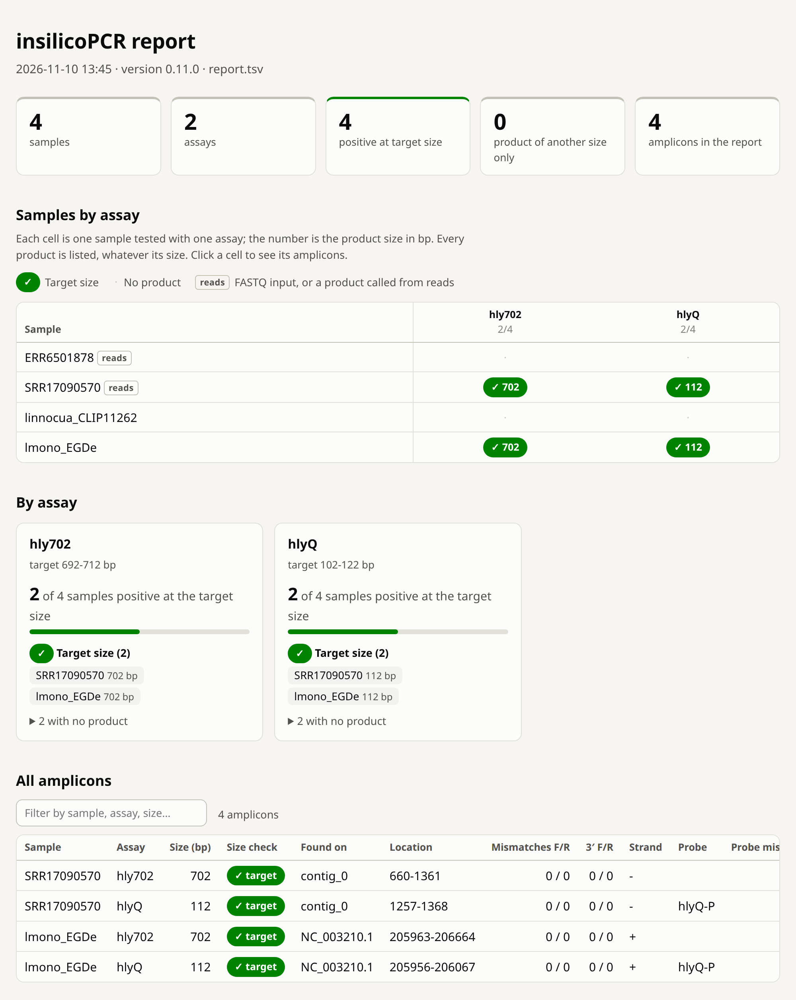
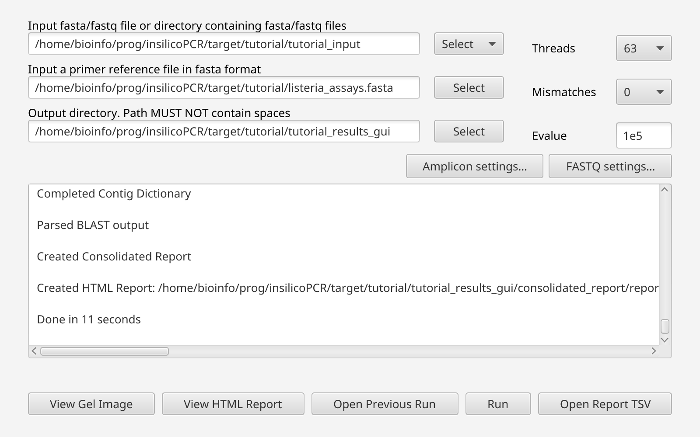

# Tutorial: Mixed PCR + qPCR Run with Controls

This tutorial walks through a complete, realistic insilicoPCR run using **public data you download yourself** — no synthetic sequences. In one single run it combines:

- a **conventional PCR assay** and a **TaqMan qPCR assay** in the same primer file (mixed mode),
- a **genome assembly** (FASTA) and **raw Illumina reads** (FASTQ) as inputs,
- a **positive control** (*Listeria monocytogenes*) and a **negative control** (*Listeria innocua*, the classic *hly*-negative near-neighbor used for exclusivity testing).

The steps below use the command line from an extracted portable release; [section 7](#7-the-same-run-in-the-gui) does the same run in the GUI. Every table and picture on this page comes from running exactly these steps with version 0.12.0 (the gel and GUI pictures with 0.11.0, which draws them the same), and the primer file and the reports of that run are in the repository under [`docs/examples/tutorial/`](https://github.com/duceppemo/insilicoPCR/tree/master/docs/examples/tutorial).

## 1. The assays

Both assays target *hly* (listeriolysin O, *hlyA*), which is present in *L. monocytogenes* and absent from *L. innocua*:

| Assay | Type | Expected product |
|---|---|---|
| `hly702` | conventional PCR (F + R) | 702 bp |
| `hlyQ` | TaqMan qPCR (F + R + probe) | 112 bp |

The `hlyQ` primers and probe are the *hlyA*-177 5'-nuclease assay of [Nogva et al. 2000, *Appl Environ Microbiol* 66:4266–4271](https://doi.org/10.1128/AEM.66.10.4266-4271.2000) (sequences as tabulated by [Iwaniak et al. 2017, *J Vet Res*](https://doi.org/10.1515/jvetres-2017-0069)); the `hly702` pair is a widely used conventional *hlyA* primer set (as tabulated, e.g., in [this virulence-gene primer table](https://pmc.ncbi.nlm.nih.gov/articles/PMC9272080/table/table002)).

Save this as `listeria_assays.fasta`:

```fasta
>hly702-F size=702
CCTAAGACGCCAATCGAA
>hly702-R
AAGCGCTTGCAACTGCTC
>hlyQ-F size=112
TGCAAGTCCTAAGACGCCA
>hlyQ-R
CACTGCATCTCCGTGGTATACTAA
>hlyQ-P
CGATTTCATCCGCGTGTTTCTTTTCG
```

Note the naming convention: `-F`/`-R`/`-P` suffixes group primers into assays, and the probe-less `hly702` assay can share the file with the probe-based `hlyQ` assay — the probe requirement is applied per assay (see [Standard PCR vs qPCR](Standard-PCR-vs-qPCR)).

The `size=` words on two of the headers are optional. They declare the product each assay is designed to give, so the reports can say whether a product has that size. insilicoPCR reports every product either way (see [Declaring product sizes](Primer-FASTA-Format#declaring-product-sizes-optional)).

## 2. Download the public data (~100 MB total)

```bash
mkdir -p tutorial_input && cd tutorial_input

# Positive control assembly: L. monocytogenes EGD-e reference genome (NCBI)
curl -L -o lmono_EGDe.fasta.gz "https://ftp.ncbi.nlm.nih.gov/genomes/all/GCF/000/196/035/GCF_000196035.1_ASM19603v1/GCF_000196035.1_ASM19603v1_genomic.fna.gz"

# Negative control assembly: L. innocua Clip11262 reference genome (NCBI)
curl -L -o linnocua_CLIP11262.fasta.gz "https://ftp.ncbi.nlm.nih.gov/genomes/all/GCF/000/195/795/GCF_000195795.1_ASM19579v1/GCF_000195795.1_ASM19579v1_genomic.fna.gz"
gunzip *.gz

# Positive control reads: L. monocytogenes Illumina WGS run SRR17090570 (ENA, ~52 MB)
curl -L -O "https://ftp.sra.ebi.ac.uk/vol1/fastq/SRR170/070/SRR17090570/SRR17090570_1.fastq.gz"
curl -L -O "https://ftp.sra.ebi.ac.uk/vol1/fastq/SRR170/070/SRR17090570/SRR17090570_2.fastq.gz"

# Negative control reads: L. innocua Illumina WGS run ERR6501878 (ENA, ~39 MB)
curl -L -O "https://ftp.sra.ebi.ac.uk/vol1/fastq/ERR650/008/ERR6501878/ERR6501878_1.fastq.gz"
curl -L -O "https://ftp.sra.ebi.ac.uk/vol1/fastq/ERR650/008/ERR6501878/ERR6501878_2.fastq.gz"

cd ..
```

The `_1`/`_2` FASTQ pairs are automatically grouped into one paired-end sample each, and the FASTQ compression is handled transparently.

## 3. Run insilicoPCR

From the extracted portable release folder:

```bash
./runtime/linux/jdk/bin/java -jar insilicoPCR.jar \
  -i tutorial_input/ \
  -p listeria_assays.fasta \
  -o tutorial_results/ \
  -t 8 \
  --gel
```

What happens, per sample:

- the two **assemblies** are BLASTed directly against the primer database;
- the two **read sets** are first baited twice with BBDuk and micro-assembled with Tadpole, and the resulting contigs are BLASTed; the baited reads themselves (pairs merged with BBMerge) are also searched, so a target the mini-assembly misses can still be called from reads, and `report_fastq_diagnostics.tsv` explains any assay whose oligos were in the reads but that the assembly missed (see [FASTQ mode and false negatives](Reports#fastq-mode-and-false-negatives));
- accepted hits are paired into amplicons (convergent orientation, ≤ 5000 bp by default, perfect 3' ends — see [Amplicon Calling](Amplicon-Calling));
- `--gel` additionally renders the synthetic gel image (requires a graphical environment).

The run takes well under a minute on a desktop machine (12 seconds here). It writes, under `tutorial_results/`:

| File | What it is |
|---|---|
| `consolidated_report/report.html` | The results as a page to read: start here |
| `consolidated_report/report.tsv` | The same results as a table, one row per amplicon |
| `consolidated_report/report_fastq_diagnostics.tsv` | For the read sets: assays not reported although their primers are in the reads (none in this run) |
| `synthetic_gel_report.png` | The gel image asked for with `--gel` |
| `detailed_report/<sample>/` | Raw BLAST hits per sample; for the read sets, also the baited reads and the mini-assembly |
| `QAlog.txt` | Version, inputs and settings |

## 4. The HTML report

Open `tutorial_results/consolidated_report/report.html` in a web browser ([the file from this run](https://github.com/duceppemo/insilicoPCR/blob/master/docs/examples/tutorial/report.html): download it and open it, GitHub only shows its source):



How to read it:

- **Samples by assay** answers the question of the run. Each row is a sample, each column an assay. The two *L. monocytogenes* samples, the assembly `lmono_EGDe` and the read set `SRR17090570`, have a green cell for both assays with the product size in it: 702 bp and 112 bp. The two *L. innocua* samples have none.
- The cells are green with a check mark because the products have the size declared in the primer file (`size=702`, `size=112`). Without the declaration they would be blue, "amplified", and the size would be yours to check; a product of another size would be outlined in red and not counted as positive.
- The `reads` tag marks the two samples given as FASTQ.
- The `◐` next to `SRR17090570`'s 702 bp product says a primer of that product binds only partly: in **All amplicons**, `5′ unpaired F/R` reads `0 / 1`, one base at the 5' end of `hly702-R` does not pair with this strain (see the last point of [section 5](#5-the-consolidated-report)). The mark hides nothing; it points at products worth a second look.
- **By assay** counts the positive samples for each assay (2 of 4) and names them.
- **All amplicons** lists every row of `report.tsv`; clicking a cell of the grid filters it to that sample and assay.

See [HTML report](Reports#html-report) for every mark the page can show.

## 5. The consolidated report

`tutorial_results/consolidated_report/report.tsv` holds the same four amplicons as a table ([the file from this run](https://github.com/duceppemo/insilicoPCR/blob/master/docs/examples/tutorial/report.tsv); columns abridged here):

| Sample | Gene | GenomeLocation | AmpliconSize | Contig | Fwd/Rev mismatches | Strand | Probe | ProbeMismatches | Fwd/Rev 5' unaligned | SizeCheck |
|---|---|---|---|---|---|---|---|---|---|---|
| SRR17090570 | hly702 | 660-1361 | **702** | contig_0 (Tadpole) | 0 / 0 | - | | | 0 / **1** | target |
| SRR17090570 | hlyQ | 1257-1368 | **112** | contig_0 (Tadpole) | 0 / 0 | - | hlyQ-P | 0 | 0 / 0 | target |
| lmono_EGDe | hly702 | 205963-206664 | **702** | NC_003210.1 | 0 / 0 | + | | | 0 / 0 | target |
| lmono_EGDe | hlyQ | 205956-206067 | **112** | NC_003210.1 | 0 / 0 | + | hlyQ-P | 0 | 0 / 0 | target |

How to read it:

- Both *L. monocytogenes* samples (assembly **and** reads) are positive for **both assays**, with the expected product sizes (702 bp and 112 bp) and zero mismatches.
- `SizeCheck` is `target` on every row: each product has the size declared for its assay. The column only exists because the primer file declares sizes; it labels rows and never removes one.
- The `hlyQ` rows carry the probe columns — the probe was found **inside** the amplicon, which is required for a qPCR assay to be called positive. The conventional `hly702` rows leave the probe columns empty.
- The *hly* coordinates from the read samples differ from the EGD-e coordinates because they are positions on the Tadpole-assembled contig, not on a reference genome.
- `Strand` is `-` for the read sample: Tadpole happened to assemble the *hly* region in the opposite orientation, so the assay matched the reverse strand — a reminder that assays are detected on either strand.
- Neither *L. innocua* sample produces a row: the primers have no acceptable binding sites. **An empty result for the negative control is the expected outcome.** (You may notice a harmless `Warning: [blastn] Query is Empty!` in the console: baiting the *L. innocua* reads with *hly* primers catches nothing, so there is no assembly to search.)
- Bonus insight: this *L. monocytogenes* strain carries a single SNP at position 4 (from the 5' end) of `hly702-R`. BLAST leaves the first four bases of the primer out of its alignment (visible in `detailed_report/SRR17090570/SRR17090570.tsv`), and `Reverse5PrimeUnaligned` counts the one of them that does not pair: `1`. 5'-proximal mismatches barely affect priming, so the hit is accepted (`--5p-truncation`, default 5) and the mismatch columns stay at `0` — exactly what a real PCR would do.

## 6. The synthetic gel

`--gel` wrote `tutorial_results/synthetic_gel_report.png`:


Each positive lane shows the two bands you would expect on a real gel — the 702 bp conventional product and the 112 bp qPCR product — while the negative-control lanes are loaded but empty, exactly like a wet-lab exclusivity control. Bands are colored by assay with a gene legend, matching the "Color by gene" option of the interactive GUI viewer (**View Gel Image**), which additionally offers hover tooltips, pagination, and SVG/PDF export.

## 7. The same run in the GUI

Start the application with `./run-insilicoPCR.sh` (Linux) or `run-insilicoPCR.bat` (Windows). Choose the `tutorial_input` folder as input, `listeria_assays.fasta` as primer file and an output folder, leave **Mismatches** at 0, and click **Run**:



The log shows each step and ends with the path of the HTML report and the run time. The reports are the same as from the command line. When the run ends:

- **View HTML Report** opens the page of section 4 in your web browser;
- **View Gel Image** opens the interactive gel viewer on the same results.

See [GUI Overview](GUI-Overview) for the other buttons and the settings dialogs.

## 8. Things to try next

- Re-run with `-m 2` and watch the same four products come out, with the same sizes and mismatch counts — the assays match their target perfectly, and near-neighbor sites still fail the 3'-end rules. Only the contig name and coordinates of the read sample change: `-m` also loosens read baiting, so the mini-assembly comes out differently.
- Re-run with `-l 100`: the 112 bp qPCR product now exceeds the maximum length and disappears; `--min-length 200` would drop it too.
- Remove the two `size=` words from the primer file and re-run: `report.tsv` loses its `SizeCheck` column and the HTML report shows the same four products in blue, as amplified with no size to compare with.
- Declare a wrong size instead (`>hly702-F size=500`) and re-run: the 702 bp products are still reported, now labelled `unexpected`, and the HTML report no longer counts them as positive. Nothing is hidden; the label only tells the reader what the size means.
- Add your own assay for a different gene to the primer FASTA — mixed files are fine as long as every ID ends in `-F`, `-R`, or `-P`.
- Open `tutorial_results/detailed_report/<sample>/<sample>.tsv` to audit the raw BLAST hits behind every call.
