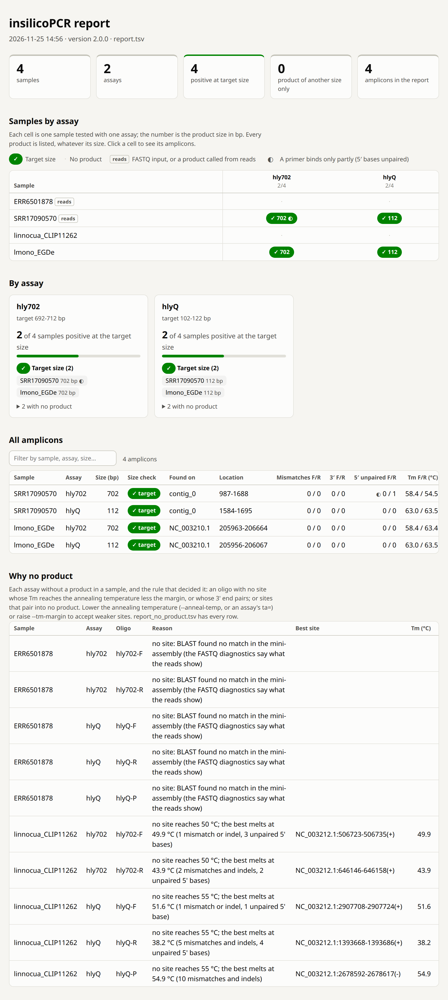
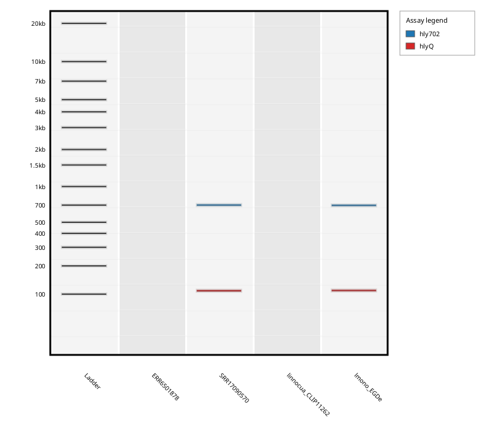
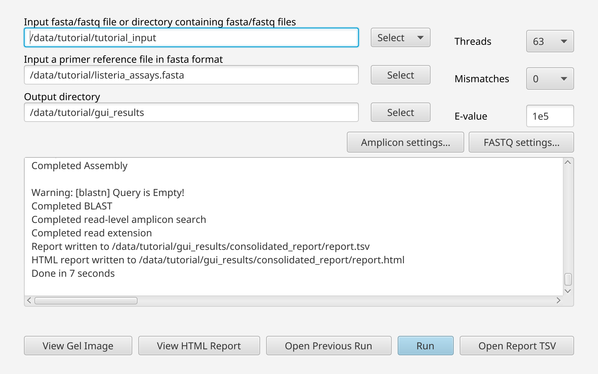

# Tutorial: Mixed PCR + qPCR Run with Controls

This tutorial walks through a complete, realistic insilicoPCR run using **public data you download yourself** — no synthetic sequences. In one single run it combines:

- a **conventional PCR assay** and a **TaqMan qPCR assay** in the same primer file (mixed mode),
- a **genome assembly** (FASTA) and **raw Illumina reads** (FASTQ) as inputs,
- a **positive control** (*Listeria monocytogenes*) and a **negative control** (*Listeria innocua*, the classic *hly*-negative near-neighbor used for exclusivity testing).

The steps below use the command line from an extracted portable release; [section 7](#7-the-same-run-in-the-gui) does the same run in the GUI. Every table and picture on this page comes from running exactly these steps with version 2.1.0 (the window of section 7 with 2.0.0, whose window is the same), and the primer file and the reports of that run are in the repository under [`docs/examples/tutorial/`](https://github.com/duceppemo/insilicoPCR/tree/master/docs/examples/tutorial).

## 1. The assays

Both assays target *hly* (listeriolysin O, *hlyA*), which is present in *L. monocytogenes* and absent from *L. innocua*:

| Assay | Type | Expected product | Published annealing temperature |
|---|---|---|---|
| `hly702` | conventional PCR (F + R) | 702 bp | 55 °C |
| `hlyQ` | TaqMan qPCR (F + R + probe) | 112 bp | 60 °C |

The `hlyQ` primers and probe are the *hlyA*-177 5'-nuclease assay of [Nogva et al. 2000, *Appl Environ Microbiol* 66:4266–4271](https://doi.org/10.1128/AEM.66.10.4266-4271.2000) (sequences as tabulated by [Iwaniak et al. 2017, *J Vet Res*](https://doi.org/10.1515/jvetres-2017-0069)), annealed at 60 °C. The `hly702` pair is a widely used conventional *hlyA* primer set, run with a 55 °C annealing step by [Coroneo et al. 2022, *Ital J Food Saf* 11:10289](https://pmc.ncbi.nlm.nih.gov/articles/PMC9272080/), whose Table 2 lists it.

The annealing temperature matters to insilicoPCR: since 2.0 a primer or probe site counts when its Tm on the template reaches the annealing temperature less 5 °C ([Why Tm](Why-Tm)). The run's is `--anneal-temp` (default 60 °C); the primer file below gives each assay its own with `ta=`, so that each is judged at the temperature it was published for, in one run.

Save this as `listeria_assays.fasta`:

```fasta
>hly702-F size=702 ta=55
CCTAAGACGCCAATCGAA
>hly702-R
AAGCGCTTGCAACTGCTC
>hlyQ-F size=112 ta=60
TGCAAGTCCTAAGACGCCA
>hlyQ-R
CACTGCATCTCCGTGGTATACTAA
>hlyQ-P
CGATTTCATCCGCGTGTTTCTTTTCG
```

Note the naming convention: `-F`/`-R`/`-P` suffixes group primers into assays, and the probe-less `hly702` assay can share the file with the probe-based `hlyQ` assay — the probe requirement is applied per assay (see [Standard PCR vs qPCR](Standard-PCR-vs-qPCR)).

The `size=` and `ta=` words on two of the headers are optional. `size=` declares the product each assay is designed to give, so the reports can say whether a product has that size; insilicoPCR reports every product either way (see [Declaring product sizes](Primer-FASTA-Format#declaring-product-sizes-optional)). `ta=` gives the assay's annealing temperature: `hly702`'s sites then need 50 °C and `hlyQ`'s 55 °C (see [Annealing temperature](Primer-FASTA-Format#annealing-temperature-optional)). `ta=60` on `hlyQ-F` repeats the default, but says where the value comes from.

## 2. Download the public data (~100 MB total)

```bash
mkdir -p tutorial_input && cd tutorial_input

# Positive control assembly: L. monocytogenes EGD-e reference genome (NCBI)
curl -L -o lmono_EGDe.fasta.gz "https://ftp.ncbi.nlm.nih.gov/genomes/all/GCF/000/196/035/GCF_000196035.1_ASM19603v1/GCF_000196035.1_ASM19603v1_genomic.fna.gz"

# Negative control assembly: L. innocua Clip11262 reference genome (NCBI)
curl -L -o linnocua_CLIP11262.fasta.gz "https://ftp.ncbi.nlm.nih.gov/genomes/all/GCF/000/195/795/GCF_000195795.1_ASM19579v1/GCF_000195795.1_ASM19579v1_genomic.fna.gz"
gunzip *.gz

# Positive control reads: L. monocytogenes Illumina WGS run SRR17090570 (ENA, ~52 MB)
curl -L -O "https://ftp.sra.ebi.ac.uk/vol1/fastq/SRR170/070/SRR17090570/SRR17090570_1.fastq.gz"
curl -L -O "https://ftp.sra.ebi.ac.uk/vol1/fastq/SRR170/070/SRR17090570/SRR17090570_2.fastq.gz"

# Negative control reads: L. innocua Illumina WGS run ERR6501878 (ENA, ~39 MB)
curl -L -O "https://ftp.sra.ebi.ac.uk/vol1/fastq/ERR650/008/ERR6501878/ERR6501878_1.fastq.gz"
curl -L -O "https://ftp.sra.ebi.ac.uk/vol1/fastq/ERR650/008/ERR6501878/ERR6501878_2.fastq.gz"

cd ..
```

The `_1`/`_2` FASTQ pairs are automatically grouped into one paired-end sample each, and the FASTQ compression is handled transparently.

## 3. Run insilicoPCR

From the extracted portable release folder:

```bash
./runtime/linux/jdk/bin/java -jar insilicoPCR.jar \
  -i tutorial_input/ \
  -p listeria_assays.fasta \
  -o tutorial_results/ \
  -t 8 \
  --gel
```

What happens, per sample:

- every input file is checked first; a sample with an empty, damaged or malformed file would be left out with a warning (see [Input check](Running-Analyses#input-check));
- the two **assemblies** are BLASTed directly against the primer database;
- the two **read sets** are first baited with BBDuk (a first bait, in two passes since 2.0, then a second bait) and mini-assembled with Tadpole, and the resulting contigs are BLASTed; the baited reads themselves (pairs merged with BBMerge) are also searched, so a target the mini-assembly misses can still be called from reads, and `report_fastq_diagnostics.tsv` explains any assay whose oligos were in the reads but that the assembly missed (see [FASTQ mode and false negatives](Reports#fastq-mode-and-false-negatives));
- a primer or probe site is accepted when its Tm on the template reaches its assay's annealing temperature less the `--tm-margin` of 5 °C: 50 °C for `hly702` (`ta=55`), 55 °C for `hlyQ` (`ta=60`) and, for a primer, its 3' end pairs; accepted primer sites are paired into amplicons (convergent orientation, ≤ 5000 bp by default — see [Amplicon Calling](Amplicon-Calling) and [Why Tm](Why-Tm));
- `--gel` additionally renders the synthetic gel image (requires a graphical environment).

The run takes well under a minute on a desktop machine (14 seconds here). It writes, under `tutorial_results/`:

| File | What it is |
|---|---|
| `consolidated_report/report.html` | The results as a page to read: start here |
| `consolidated_report/report.tsv` | The same results as a table, one row per amplicon |
| `consolidated_report/report_samples.tsv` | Every sample, with its number of products (since 1.0): the two *L. innocua* samples are there with `0` |
| `consolidated_report/report_no_product.tsv` | Every assay without a product in a sample, and why (since 2.0) |
| `consolidated_report/report_fastq_diagnostics.tsv` | For the read sets: assays not reported although their primers are in the reads (none in this run; without `ta=55`, one: see [section 5](#5-the-consolidated-report)) |
| `synthetic_gel_report.png` | The gel image asked for with `--gel` |
| `detailed_report/<sample>/` | The BLAST hits behind each sample's products; for the read sets, also the baited reads and the mini-assembly |
| `QAlog.txt` | Version, inputs and settings |

## 4. The HTML report

Open `tutorial_results/consolidated_report/report.html` in a web browser ([the file from this run](https://github.com/duceppemo/insilicoPCR/blob/master/docs/examples/tutorial/report.html): download it and open it, GitHub only shows its source):



How to read it:

- **Samples by assay** answers the question of the run. Each row is a sample, each column an assay. The two *L. monocytogenes* samples, the assembly `lmono_EGDe` and the read set `SRR17090570`, have a green cell for both assays with the product size in it: 702 bp and 112 bp. The two *L. innocua* samples have none.
- The cells are green with a check mark because the products have the size declared in the primer file (`size=702`, `size=112`). Without the declaration they would be blue, "amplified", and the size would be yours to check; a product of another size would be outlined in red and not counted as positive.
- The `reads` tag marks the two samples given as FASTQ.
- The `◐` next to `SRR17090570`'s 702 bp product says a primer of that product binds only partly: in **All amplicons**, `5′ unpaired F/R` reads `0 / 1`, one base at the 5' end of `hly702-R` does not pair with this strain (see [section 5](#5-the-consolidated-report)). The mark hides nothing; it points at products worth a second look.
- **By assay** counts the positive samples for each assay (2 of 4) and names them.
- **All amplicons** lists every row of `report.tsv`, with the Tm of each primer on its site (`Tm F/R`); clicking a cell of the grid filters it to that sample and assay.
- **Why no product** (since 2.0) gives, for each sample and assay without a product, the oligo that has no acceptable site, its best site and that site's Tm: here the two *L. innocua* samples.

See [HTML report](Reports#html-report) for every mark the page can show.

## 5. The consolidated report

`tutorial_results/consolidated_report/report.tsv` holds the same four amplicons as a table ([the file from this run](https://github.com/duceppemo/insilicoPCR/blob/master/docs/examples/tutorial/report.tsv); columns abridged here):

| Sample | Assay | GenomeLocation | AmpliconSize | Contig | Fwd/Rev mismatches | Strand | Probe | Fwd/Rev 5' unpaired | SizeCheck | Fwd/Rev Tm | ProbeTm |
|---|---|---|---|---|---|---|---|---|---|---|---|
| SRR17090570 | hly702 | 987-1688 | **702** | contig_0 (Tadpole) | 0 / 0 | - | | 0 / **1** | target | 58.4 / **54.5** | |
| SRR17090570 | hlyQ | 1584-1695 | **112** | contig_0 (Tadpole) | 0 / 0 | - | hlyQ-P | 0 / 0 | target | 63.0 / 63.5 | 67.2 |
| lmono_EGDe | hly702 | 205963-206664 | **702** | NC_003210.1 | 0 / 0 | + | | 0 / 0 | target | 58.4 / 63.4 | |
| lmono_EGDe | hlyQ | 205956-206067 | **112** | NC_003210.1 | 0 / 0 | + | hlyQ-P | 0 / 0 | target | 63.0 / 63.5 | 67.2 |

How to read it:

- Both *L. monocytogenes* samples (assembly **and** reads) are positive for **both assays**, with the expected product sizes (702 bp and 112 bp) and zero mismatches.
- `SizeCheck` is `target` on every row: each product has the size declared for its assay. The column is filled only because the primer file declares sizes; it labels rows and never removes one.
- The `hlyQ` rows carry the probe columns — the probe was found **inside** the amplicon, which is required for a qPCR assay to be called positive. The conventional `hly702` rows leave the probe columns empty.
- `ForwardTm`, `ReverseTm` and `ProbeTm` (since 2.0) give each oligo's Tm on its site. A site that pairs perfectly gives the oligo's own Tm, which the run's log also lists; all are above the Tm their assay's sites need (50 °C for `hly702`, 55 °C for `hlyQ`).
- The *hly* coordinates from the read sample differ from the EGD-e coordinates because they are positions on the Tadpole-assembled contig, not on a reference genome. `Strand` is `-` there: Tadpole happened to assemble the *hly* region in the opposite orientation, so the assay matched the reverse strand — a reminder that assays are detected on either strand.
- Neither *L. innocua* sample produces a row. **An empty result for the negative control is the expected outcome.** `report_no_product.tsv` says why for each assay and oligo: on the `linnocua_CLIP11262` assembly, the best site of each oligo melts short of what its assay needs: `hlyQ-P` at 54.9 °C against 55 °C and `hly702-F` at 49.9 °C against 50 °C come closest, `hlyQ-R` at 38.2 °C least; in the `ERR6501878` reads, BLAST finds no site at all. (You may notice a harmless `Warning: [blastn] Query is Empty!` in the console: baiting the *L. innocua* reads with *hly* primers catches nothing, so there is no assembly to search.)

**The one weak site, and the annealing temperature.** This strain differs from `hly702-R` at its 4th base from the 5' end (`AAGTG...` where the primer reads `AAGCG...`). BLAST leaves the first four bases of the primer out of its alignment (visible in `detailed_report/SRR17090570/SRR17090570.tsv`), so the mismatch columns stay at `0` and `Reverse5PrimeUnpaired` counts the one of them that does not pair: `1`. The Tm weighs it: the primer melts at 63.4 °C on its perfect complement and at 54.5 °C on this site. A mismatch that close to the 5' end still costs this primer 9 °C.

That site is why `ta=55` matters:

| `hly702` judged at | A site needs | `SRR17090570`, `hly702` | Products |
|---|---|---|---|
| **55 °C, its published temperature (`ta=55`, this tutorial)** | **50 °C** | **702 bp** | **4** |
| 60 °C, the default, without `ta=` | 55 °C | no product: 54.5 °C is short of 55 °C | 3 |

Without `ta=55`, `report_no_product.tsv` has the row below (wrapped, and the contig's name cut at its first comma, as the HTML report shows it), and `report_fastq_diagnostics.tsv` lists the assay as `PARTIAL_BAIT`: 36 reads carry a forward site, and none a reverse site that the rules accept, though the mini-assembly holds the rejected one.

```text
SRR17090570  hly702  hly702-R  no site reaches 55 °C in the mini-assembly (the FASTQ diagnostics say what the reads
                               show); the best melts at 54.5 °C (1 unpaired 5' base)    contig_0:664-677(+)  54.5  55.0
```

So **give each assay the annealing temperature it was published for**: `--anneal-temp` for the whole run, `ta=` for an assay that differs. insilicoPCR 1.0.0 reported this product whatever the temperature, since the mismatch was among the 5 free 5' bases of `--5p-truncation`.

## 6. The synthetic gel

`--gel` wrote `tutorial_results/synthetic_gel_report.png`:



Each positive lane shows the two bands you would expect on a real gel — the 702 bp conventional product and the 112 bp qPCR product — while the negative-control lanes are loaded but empty, exactly like a wet-lab exclusivity control. Bands are colored by assay with an assay legend, matching the **Color: By assay** choice (**By gene** before 1.0) of the interactive GUI viewer (**View Gel Image**), which additionally offers colours by size check (target, other known product, unexpected), hover tooltips, pagination, and SVG/PDF export.

## 7. The same run in the GUI

Start the application with `./run-insilicoPCR.sh` (Linux) or `run-insilicoPCR.bat` (Windows). Choose the `tutorial_input` folder as input, `listeria_assays.fasta` as primer file and an output folder, leave **Anneal (°C)** at 60 (the `ta=` words of the primer file set each assay's own), and click **Run**:



The log shows each step and ends with the path of the HTML report and the run time. The reports are the same as from the command line. When the run ends:

- **View HTML Report** opens the page of section 4 in your web browser;
- **View Gel Image** opens the interactive gel viewer on the same results.

See [GUI Overview](GUI-Overview) for the other buttons and the settings dialogs.

## 8. Things to try next

- Remove `ta=55` from `hly702-F` and re-run: `hly702` is judged at the default 60 °C, `SRR17090570` loses its 702 bp product, and `report_no_product.tsv` says why ([section 5](#5-the-consolidated-report)).
- Re-run with `--tm-margin 12` (sites at 43 °C for `hly702`, 48 °C for `hlyQ`): the same products come out, and a further one on `lmono_EGDe`: `hly702`, 3226 bp, labelled `unexpected`, made by the same primers at two sites 3 kb apart, the forward one with 2 mismatches and 4 unpaired 5' bases (`ForwardMismatches 2`, `Forward5PrimeUnpaired 4`), melting at 48.5 °C (`ForwardTm`). A permissive margin lets primers pair at other places of a genome; the `SizeCheck` label tells the designed product from such one, and `ForwardTm` shows how weak the site is.
- Re-run with `-l 100`: the 112 bp qPCR products now exceed the maximum length and disappear, leaving no product at all; `--min-length 200` would drop them too.
- Remove the two `size=` words from the primer file and re-run: `report.tsv` leaves its `SizeCheck` column empty and the HTML report shows the same four products in blue, as amplified with no size to compare with.
- Declare a wrong size instead (`>hly702-F size=500`) and re-run: the 702 bp products are still reported, now labelled `unexpected`, and the HTML report no longer counts them as positive. Nothing is hidden; the label only tells the reader what the size means.
- Add your own assay for a different gene to the primer FASTA — mixed files are fine as long as every ID ends in `-F`, `-R`, or `-P` (or has one of them before an underscore, `toxA-F_2`).
- Open `tutorial_results/detailed_report/<sample>/<sample>.tsv` to audit the BLAST hits behind every call.
