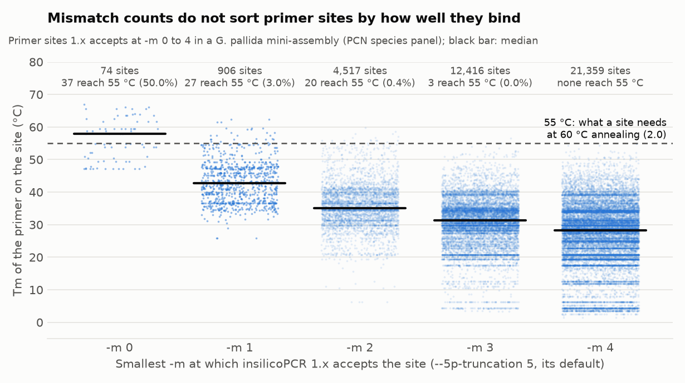

# Why Tm

insilicoPCR 1.x accepted a primer site when it had few enough mismatches (`-m`), with a few 5' bases free (`--5p-truncation`). Since 2.0 a site is accepted when its **melting temperature on the template** reaches the annealing temperature less a margin (60 − 5 = 55 °C by default), and a primer's 3' end still has to pair ([Amplicon Calling](Amplicon-Calling)). The Tm is Primer3's thermodynamic alignment (`ntthal`), ported to Java. This page shows why the Tm is the better rule, on data, and where the two disagree.

In short: a mismatch count says how many bases differ, not how well the oligo binds. On real data the count lets through sites that cannot bind at the reaction's temperature and turns away sites that can. The Tm puts the sites in the order a reaction does, with one rule for every assay: its sites judged at its annealing temperature, the run's or the one its primer header gives (`ta=`, [Primer FASTA Format](Primer-FASTA-Format#annealing-temperature-optional)).

## A count does not weigh a mismatch

One mismatch, or five unpaired 5' bases, counted the same in 1.x wherever they were and whatever the primer. Their cost in Tm, as the program computes it (on the template under the primer, at the 60 °C reaction defaults; mismatches outside the 3' window, which the 3' rule judges anyway; an unpaired 5' base faces its own base):

| Primer | Length | Tm, perfect site | Tm, one mismatch | Tm, 2 / 5 / 8 unpaired 5' bases |
|---|---|---|---|---|
| `GGAAGTAAAAGTCGTAACAAGG` (ITS5) | 22 | 58.7 °C | 41.4 to 57.7 °C | 57.0 / 50.7 / 47.3 °C |
| `ACGGACACATGCCCGCTA` | 18 | 65.5 °C | 54.9 to 66.8 °C | 60.7 / 56.7 / 41.2 °C |
| `GTGTCTCTAATTTGCCATT` | 19 | 54.6 °C | 34.3 to 53.7 °C | 51.9 / 41.7 / 36.3 °C |
| `TTTCCTCATGCAATTCAAAACC` | 22 | 59.7 °C | 42.2 to 59.7 °C | 58.8 / 51.8 / 47.1 °C |
| `CCAGCAGATTCTTTTTTACATCA` | 23 | 59.1 °C | 50.8 to 58.7 °C | 55.7 / 47.9 / 42.4 °C |

- **Where a mismatch sits matters.** In the ITS5 primer, one mismatch costs 1 to 2 °C at its 5' end and up to 17 °C at its 8th base. To 1.x both were "1 mismatch".
- **The primer matters.** Five unpaired 5' bases leave a GC-rich 18-mer at 56.7 °C, still a site, and an AT-rich 19-mer at 41.7 °C, not one. To 1.x at `--5p-truncation 5` both were perfect.
- **A perfect site is not always a site.** `GTGTCTCTAATTTGCCATT` melts at 54.6 °C on its own perfect complement, below the 55 °C a site needs at 60 °C. A count of 0 cannot say so; the run's log lists every oligo's Tm on a perfect match and flags one below the minimum.
- **Nor is it a ceiling.** A mismatch at the very 5' end can stack on the duplex: the 18-mer melts at 66.8 °C with its first base mismatched, 1.3 °C above its perfect site. The Tm counts what binds, not what differs.

## On real data: every primer site in an assembly

Every primer site in the mini-assembly of a *Globodera pallida* cyst sample (Illumina reads, CFIA; 16 PCR and qPCR assays for potato cyst nematodes, with the EPPO PM 7/40 tests), sorted by the smallest `-m` at which 1.x accepts it, against its Tm:



| 1.x accepts the site at | Sites | Melting at 55 °C or more |
|---|---|---|
| `-m 0` (1.x default) | 74 | 37 (50%), the others from 47 °C |
| `-m 1` | 906 more | 27 (3.0%) |
| `-m 2` | 4,517 more | 20 (0.4%) |
| `-m 3` | 12,416 more | 3 |
| `-m 4` | 21,359 more | none |

The count fails both ways:

- **It lets through sites that cannot bind.** Half of the sites 1.x accepts by default melt below 55 °C, down to 47 °C. Each mismatch allowed then lets in thousands of sites for a few dozen that bind: at `-m 2`, 5,497 sites, 84 of them at 55 °C or more.
- **It turns away sites that can.** 47 sites that need `-m 1` or `-m 2` melt above 55 °C, up to 62.4 °C, above half of the sites `-m 0` accepts. No `-m` keeps them and drops the others.

## On whole runs

The products of the same data, as 1.x calls them at its default and with mismatches allowed, and as 2.0 calls them at its default (60 °C, margin 5):

| Data | 1.x, `-m 0` (default) | 1.x, mismatches allowed | 2.0 default |
|---|---|---|---|
| 46 *Brucella* genome assemblies (NCBI), 4-assay qPCR panel | 21 | 59 (`-m 3 --5p-truncation 8`) | 22 |
| *G. pallida* sample, mini-assembly as FASTA | 0 | 241 (`-m 1 --5p-truncation 8`) | 0 |
| *G. pallida* sample, reads (FASTQ mode) | 3 | 1,021 (`-m 1 --5p-truncation 8`) | 3 |

- ***Brucella*.** 2.0 gives the 21 products of strict 1.x, and one more: BM_10's 147 bp product on GCA_000292205.2, whose primers pair perfectly and whose probe has one mismatch in a site that still melts above 55 °C. `-m 0` rejects it on the probe's count. Allowing mismatches gave 38 more products: BM_10's, and 37 of BA and Bru_genus, from sites with mismatches and unpaired 5' bases; 2.0 gives none of them.
- ***G. pallida* reads.** 2.0 and strict 1.x give the same three *G. pallida* products: NakhlaPal, NakhlaPalPCR and ReidPal, each at its target size, called from reads whose primer and probe sites pair perfectly. Allowing one mismatch and 8 free 5' bases in 1.x gave 1,018 more, 980 of them from the *G. rostochiensis* and *G. tabacum* tests NakhlaRosPCR and NakhlaTabPCR (33 at their target size), on a *G. pallida* sample. 2.0 gives none of them.

So 2.0 at its default is as strict as 1.x at `-m 0` where that was right, and gives what `-m 0` missed when the site still binds (BM_10). 1.x users who needed that loosened `-m` and `--5p-truncation`, and got the false products with it: the Tm needs no such choice. For every assay without a product, `report_no_product.tsv` gives the reason. On the *G. pallida* reads it also names GamelRos-R, whose Tm on a perfect match is 54.6 °C: at 60 °C it is unlikely to anneal anywhere, whatever the sample.

## Where the Tm says no

The Tm rule is the same for every assay, and some published assays fail it in silico, even at their own annealing temperature. On the *G. pallida* reads, the EPPO PM 7/40 test of Bulman and Marshall (1997), run at its published 60 °C, gives no product: its universal ITS5 primer differs from *G. pallida* at 5 of its first 6 bases, and its site melts at 51.5 °C. `report_no_product.tsv` says so:

```text
BMpal  BMpal-F  no site reaches 55 °C in the mini-assembly (the FASTQ diagnostics say what the reads
                show); the best melts at 51.5 °C (1 mismatch or indel, 4 unpaired 5' bases)
```

1.x at `-m 0` gave no product either: the mismatch at the 6th base is past its 5 free bases.

The test works at the bench: from the second cycle on, the primer anneals to copies of the product, which carry its whole sequence. insilicoPCR does not try to model that for one assay: with `--tm-margin 10` (sites at 50 °C), the reads give its 266 bp product, from 1,535 of 1,696 informative reads (91%). The point is not to make the assay pass: its weak site is the finding. One rule for every assay shows which ones rely on a weak site, and how weak.

## What the margin shows

The margin (`--tm-margin`, 5 °C by default) sets how far below the annealing temperature a site may melt. The aim of insilicoPCR is not to make every assay give its product: an assay that gives none at the default relies on a weak site, and that is worth knowing before it is used on new samples. To see where the margin matters, both data sets were run at 60 °C with a margin of 15 (sites at 45 °C), keeping every product down to 45 °C, and each product was sorted by its weakest site: the lowest of its `ForwardTm`, `ReverseTm` and `ProbeTm`.

**46 *Brucella* assemblies** (NCBI, 4-assay qPCR panel at 60 °C). The products split cleanly:

| Products | Weakest site |
|---|---|
| The 22 of the 2.0 default (Bru_genus 16, BM_10 3, BS 2, BA 1), each at its target size | 61.3 to 61.9 °C |
| 3 more, BA products not at its target size | 45.1 °C |

Any minimum from 46 to 61 °C gives the same 22 products: at 60 °C, any margin from 0 to 14. The default's 55 °C sits in the gap. These assays have strong sites on their targets: the margin hardly matters.

***Globodera* reads** (FASTQ mode; 19 cyst samples, CFIA: nine *G. rostochiensis*, two of its Andean mitotype, three each of *G. pallida* and *G. ellingtonae*, one *G. tabacum*, and a nematode outside *Globodera*). The 14 species assays were each judged at their published annealing temperature: Gamel et al. (2017), Bulman and Marshall (1997) and Reid et al. (2015) at 60 °C (EPPO PM 7/40(5), Appendices 3, 6 and 4; the Reid protocol's 2 min at 50 °C before the 95 °C start is the UNG step, not its annealing), Chronis et al. (2014) at 60 °C (the protocol of Yu et al. (2011) it follows), Nakhla et al. (2010) at 58 °C, and ShahGe, the outer primers F3 and B3 of the Shah and Dandurand (2026) LAMP assay, at the 62 °C of their PCR in that paper. Counting each assay once per sample, with a product at its target size: 64 are an assay on its own species, and 8 on another.

| Margin | On its own species (of 64) | On another species | Own-species products missing |
|---|---|---|---|
| 0 to 1 | 27 | 4 | BMros, BMpal, GamelRos, ReidRos, ReidPal, ChronisGe, ShahGe |
| 2 | 29 | 8 | BMros, BMpal, GamelRos, ReidRos, ReidPal, ChronisGe, ShahGe |
| 3 to 4 | 32 | 8 | BMros, BMpal, GamelRos, ReidRos, ReidPal, ShahGe |
| **5 to 8** (default 5) | **46** | 8 | BMros, BMpal, GamelRos, ReidRos (one sample) |
| 9 | 63 | 8 | ReidRos (one sample) |
| 10 or more | 64 | 8 | none |

The assays are weak in two ways, and the runs show both:

- **Sensitivity: four published assays rely on a weak site.** BMros and BMpal share the ITS5 primer, whose sites on these samples melt at 51.5 °C (see above). GamelRos-R melts at 54.6 °C even on a perfect match, and at 51.2 °C on these samples, with one unpaired 5' base. At their published 60 °C they give no product at the default, and `report_no_product.tsv` names the oligo and its Tm. The Reid assays' 15-base probes melt at 55.8 °C on a perfect match, just above the 55 °C a site needs at the default; on one *G. rostochiensis* sample, whose reads carry a mismatch under the ReidRos probe, its site melts at 50.4 °C and ReidRos gives no product. Their probes carry a minor-groove binder (MGB), which raises a probe's Tm and which the Tm here does not model: on the bench they hold more than these numbers show. BMros, BMpal and GamelRos work at the bench, but with little room: a further mismatch in a population, or a less forgiving mix, and they may not.
- **Specificity: from a margin of 2, every margin keeps the 8 products on another species.** ReidRos's on the three *G. ellingtonae* samples and the *G. tabacum* one (its probe's detection of *G. tabacum* is documented), with a weakest site at 58.2 °C, higher than its probe's 55.8 °C on its own species, and NakhlaTab's and NakhlaTabPCR's on the two Andean *G. rostochiensis* samples, at 61.7 °C, melt as high as the assays' sites on their own species, or higher (NakhlaTab's on *G. tabacum* is at 59.9 °C). A margin of 0 or 1 removes ReidRos's four only by removing ReidRos on its own species too. The oligos match these species: a result on them needs another test.

The assay's own annealing temperature matters as much as the margin: give each assay its published one with `ta=`, and read a protocol's cycling with care (a 50 °C UNG step is not an annealing temperature).

The default stays at 5 °C. A wider one would hide the weak sites: at 10 °C or more every *Globodera* product is there, and the four assays above look as safe as the others.

When an assay gives no product:

1. Read its line in `report_no_product.tsv`, and the oligo Tms at the top of the run's log (each oligo's Tm on a perfect match, flagged when below the minimum).
2. Check that it is judged at its own annealing temperature: give it with `ta=` in its primer header ([Primer FASTA Format](Primer-FASTA-Format#annealing-temperature-optional)) if the run's is not it.
3. If it still gives none, the reason is a finding about the assay. A run with a larger `--tm-margin` shows how far it is from passing, and what it would amplify if the site does anneal; it does not make the site any stronger.

## What the Tm does not do

- It is the Tm of the duplex at equilibrium, for the reaction the settings describe (`--na`, `--mg`, `--dntp`, `--oligo-conc`; the defaults are a typical qPCR mix). It is not an amplification efficiency, and it does not see primer dimers, hairpins or competition between assays.
- The 3' rule is still needed: a duplex can melt above the minimum with a mismatched 3' end that the polymerase does not extend.
- The comparisons above are in silico: they show that the Tm and a mismatch count disagree, and on which sites, not wet-lab outcomes. The *G. pallida* data are not public; the *Brucella* genomes are on NCBI.
- It costs time: 46 *Brucella* genomes take 29 s instead of 18 s, and the *G. pallida* reads 30 min instead of 26 min at `-m 0` (44 min at `-m 1 --5p-truncation 8`, which has many more weak products to follow in the reads).

See also [Amplicon Calling](Amplicon-Calling) for the rules, [Reports](Reports) for the `ForwardTm`/`ReverseTm`/`ProbeTm` columns and `report_no_product.tsv`, and [Limitations](Limitations).
